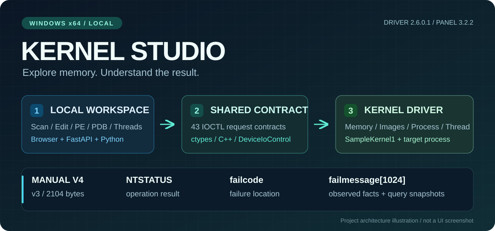
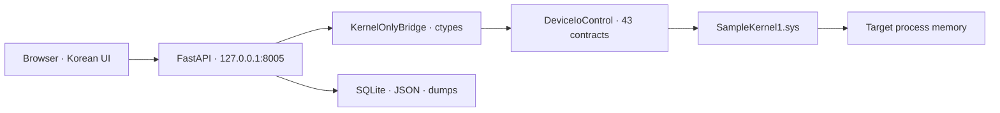
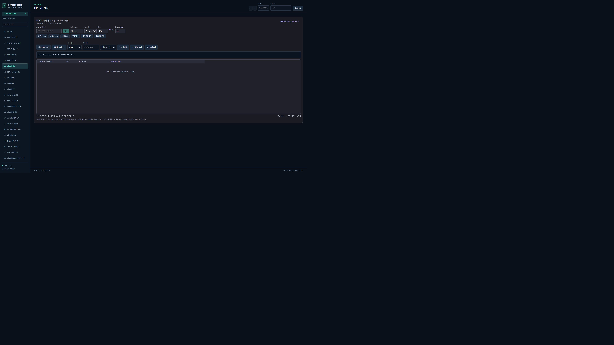
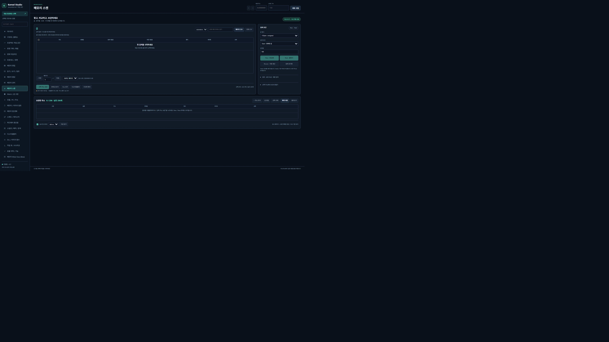
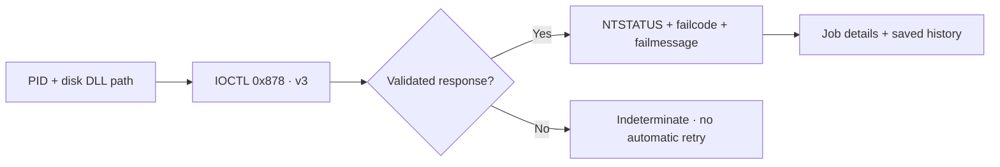

<div align="center">

# Kernel Based Process Memory Editor

**SampleKernel1 · Kernel Studio**<br>
A local workspace for Windows process memory, backed by a kernel driver.


[한국어](README.md) · **English** · [简体中文](README.zh-CN.md) · [Español](README.es.md)



[Quick start](#quick-start) · [ManualV4 diagnostics](#manualv4-diagnostics) · [User guide](docs/en/GUIDE.md) · [API / ABI](docs/reference/API_ABI.md)

</div>

> [!IMPORTANT]
> This source update pairs **driver 2.6.0.1** with **panel 3.2.2**. ManualV4 uses **packet v3, 2104 bytes**; v1/v2 clients are incompatible. Rebuilding a `.sys` does not replace the driver already loaded in Windows.

## A workbench, not a wall of hex

Choose a process, inspect its memory, narrow scan candidates, and move an address into the editor, Watch, PE tools or disassembly. Kernel Studio brings those workflows together in a local browser UI.

The UI remains **Korean**. These translated documents explain the same source and controls; they do not imply a translated application.

| Workspace | What it provides |
|---|---|
| Memory editor / management | Typed reads and writes, byte editing, allocation, protection, copy and fill |
| Scan / Watch | New → Next scans, AOB and strings, SQLite candidates, saved addresses and value freeze |
| Images / PE | Modules, sections, imports/IAT, exports, address ownership and optional PDB symbols |
| Disassembly / structures | x86/x64 instructions, CFG, patch preview, pointer chains and user-defined fields |
| Threads / breakpoints | General registers, suspend/resume, priorities and hardware breakpoint management |
| Dumps / projects | Large range and mapped-image dumps, progress/cancel, manifests and recovery records |
| ManualV4 | Kernel DLL mapping with operation status, failure location and detailed diagnostics |

> [!TIP]
> “It is probably the right address” is a brave debugging strategy. Preview the bytes and check the selected process first; your future self already has enough tabs open.

## The path your request takes



Target reads, writes and memory-region queries use the driver. User mode compares returned bytes, manages scan candidates and parses PE/instructions. The device connection uses `CreateFileW`, `DeviceIoControl` and `CloseHandle`.

**43 request contracts** cover `0x800`–`0x829` and ManualV4 `0x878`. The complete inventory belongs in the [API / ABI reference](docs/reference/API_ABI.md), where structure details are easier to find than in a scrolling marathon.

## A glimpse of the workspace

| Memory editor | Memory scan |
|---|---|
|  |  |

*Historical screenshots from 2026-10-05–06, captured before choosing a target. They illustrate the existing UI and do not show the new 3.2.2 ManualV4 diagnostics. See [image provenance](docs/images/README.md).*

## Quick start

Use Windows x64, **64-bit Python**, and Visual Studio 2022 C++ tools with a compatible Windows SDK/WDK for driver builds. The development validation used Python 3.14.5. Dependencies are specified in [requirements.txt](kernel_control_panel/requirements.txt); version ranges are not a lockfile.

From Developer PowerShell at the repository root:

```powershell
msbuild SampleKernel1.sln /t:Rebuild /m /p:Configuration=Release /p:Platform=x64 /p:SignMode=Off
```

The output is `x64\Release\SampleKernel1.sys`. This command builds an **unsigned** driver; installation/loading requires a signing and deployment setup accepted by your test system. The repository supplies source, not a WHQL-certified installer. See the [setup guide](docs/en/GUIDE.md).

Start the source panel:

```powershell
cd kernel_control_panel
py -3 -m venv .venv
.\.venv\Scripts\Activate.ps1
python -m pip install -r requirements.txt
python kernel_studio.py
```

Open **[http://127.0.0.1:8005/](http://127.0.0.1:8005/)**. `python server.py` uses the same default port; `python kernel_studio.py --port 8006` selects another one. Run a single server worker.

1. Verify the **loaded driver** version in the dashboard.
2. Open **대상 프로세스 선택** and choose your test target.
3. Read a known address or run New / Next to find a value.
4. Inspect the result before applying writes, freezes or thread changes.

> [!NOTE]
> Process discovery probes PID ranges through the existing kernel query contract. It is not complete system-wide enumeration. Expand the range or enter a PID manually when a process is missing.

To package the panel, activate the build environment, install PyInstaller and run `tools\build_release.cmd` inside `kernel_control_panel`. It writes to a fresh `dist/3.2.2/KernelStudio` directory, or a new timestamped child when that version directory exists, preserving earlier packages and data.

## ManualV4 diagnostics

Enter a disk DLL's absolute path, such as `C:\DLLs\Example.dll`, in **ManualV4**. The panel checks process identity immediately before submitting the PID and path to the kernel.



| Field | Meaning |
|---|---|
| `ResultStatus` / NTSTATUS | The kernel operation's returned status |
| `failcode` | `0` for success; a positive value identifies a failure branch |
| `failmessage[1024]` | ANSI diagnostics: at most 1023 ASCII bytes, NUL terminated, zero-filled tail |
| `MappedBase` / `EntryPoint` | Returned image base and entry point; shown as hexadecimal strings |

The packet layout is defined once in [manual_map_protocol.h](manual_map_protocol.h): `failcode` is at offset **1076**, and `failmessage` at **1080**. The first failure diagnosis is retained even when cleanup changes the final operation status. Long messages end in `[truncated]`.

For example, **failcode 119** identifies a section's `ZwProtectVirtualMemory` failure. Its message includes the section name/index, RVA, sizes, requested protection, addresses and NTSTATUS. It reports observed facts; an `ACCESS_DENIED` status does not by itself prove a particular policy cause.

Protection branches **117 / 118 / 119 / 123** also capture:

- `pre_page`: first-region state, type, current/allocation protection, base, size and request coverage.
- `pre_dynamic`: raw dynamic-code flags and decoded policy bits.
- `pre_protection`: protection level, type, audit bit and signer.

> [!IMPORTANT]
> These are **read-only pre-call queries**. They do not set a policy, relax permissions or change the original protection arguments. Failed/unsupported/malformed queries are `UNAVAILABLE`, not “policy disabled.” The snapshot is not atomic across an actively changing process.

> [!WARNING]
> A successful HTTP request or IOCTL transport is not proof of a successful DLL map. Check the validated job state and kernel result. Missing or invalid diagnostics become `null` / indeterminate; the panel does not retry mapping automatically.

Refreshing a job list only reads its state. For the full workflow and limitations, see the [guide](docs/en/GUIDE.md) and [panel reference](kernel_control_panel/README_ko.md#manualv4-커널-매핑).

## Build, test, and know what was tested

The latest development checks recorded **561 Python tests**, **8 UI test groups**, and **2009 native checks across 135 failure locations**, plus x64 Release/Debug and panel builds. These are build/regression results, not a claim that every operation was exercised against a live target on every Windows build.

```powershell
# From the repository root: fixture for PE / PDB tests
powershell -NoProfile -ExecutionPolicy Bypass -File samples/build_fixture.ps1
cd kernel_control_panel
python -m unittest discover -p 'test*.py' -v
node test_manual_v4_ui.js
python native/manual_map/run_selftest.py
```

The native mapper harness compiles the **current mapper body** against mock DDIs, adapting includes only. It does not open a driver or map a DLL into a real process. Full Python discovery needs the DLL/PDB fixture and DIA helper; see [samples](samples/README.md) and [validation scope](docs/VALIDATION.md).

`test_driver_readonly.py` and `test_driver_all_ioctl.py` run the same seven read-only diagnostics when explicitly used with a loaded driver; the latter name does not mean all 43 operations were live-tested.

## Practical limits

- x64 is the supported development target; ARM64 configurations are not a compatibility guarantee.
- Reading a changing process through several requests is not an atomic snapshot.
- Mapped-image dumps preserve RVA layout and are not reconstructed executable disk PE files.
- Writes, freezes, protection edits and thread operations affect actual target state.
- Source panel data and packaged panel data have different storage roots; see the [guide](docs/en/GUIDE.md).

## Find the details without losing the afternoon

| Document | Purpose |
|---|---|
| [Setup and user guide](docs/en/GUIDE.md) | Build, start, select a target and troubleshoot |
| [API / ABI](docs/reference/API_ABI.md) | Request contracts and wire layouts |
| [Panel source guide](kernel_control_panel/README_ko.md) | Detailed current Korean feature guide |
| [DLL workbench](kernel_control_panel/DLL_WORKBENCH.md) | Images, symbols and calls |
| [Validation](docs/VALIDATION.md) | Test evidence and its limits |
| [Fixture](samples/README.md) | Rebuild the synthetic DLL/PDB test inputs |
| [Contributing](CONTRIBUTING.md) / [Security](SECURITY.md) | Reports and repository workflow |
| [License status](LICENSE_STATUS.md) | No license is assigned on the owner's behalf |

No generated driver/panel packages, user dumps, uploaded DLL/PDBs or signing certificates are required in Git. Build outputs stay local; source and reproducible support files belong here.
