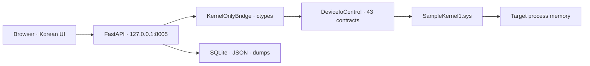

<div align="center">

# Kernel Based Process Memory Editor

**SampleKernel1 · Kernel Studio**<br>
A local workspace for Windows process memory, backed by a kernel driver.


[한국어](README.md) · **English** · [简体中文](README.zh-CN.md) · [Español](README.es.md)


[Quick start](#quick-start) · [Features by navigation](#features) · [User guide](docs/en/GUIDE.md) · [API / ABI](docs/reference/API_ABI.md)

</div>

> [!IMPORTANT]
> This source update pairs **driver 2.6.0.2** with **panel 3.2.3**. ManualV4 uses **packet v3, 2104 bytes**; v1/v2 clients are incompatible. Rebuilding a `.sys` does not replace the driver already loaded in Windows.

<a id="features"></a>

## Navigation, one workspace at a time

The list follows the panel sidebar. Korean labels in parentheses match the application UI.

| Navigation | What it does |
|---|---|
| **대시보드 (Dashboard)** | Check driver connection, selected target and recent workspace status. |
| **구조체 / 클래스 (Structures / Classes)** | Define and inspect fields and offsets for user-defined memory layouts. |
| **프로젝트 작업 공간 (Project Workspace)** | Save and restore analysis settings, addresses and scan state as projects. |
| **변경 기록 / 묶음 (Change Log / Bundles)** | Group change items, add notes and review them later. |
| **변화 타임라인 (Change Timeline)** | Sample selected values and bytes over time, then compare two observations. |
| **프로세스 / 권한 (Processes / Access)** | Inspect process details, tokens, handles and related threads. |
| **EPROCESS 구조체 (EPROCESS Structure)** | Explore kernel process-object fields using versioned layouts. |
| **메모리 편집 (Memory Editor)** | Read and edit a selected address using typed values or individual bytes. |
| **읽기 / 쓰기 / 덤프 (Read / Write / Dump)** | Issue raw memory requests and dump bytes from an address range. |
| **메모리 할당 (Memory Allocation)** | Allocate a memory region in the selected process and inspect its address. |
| **메모리 관리 (Memory Management)** | Manage allocation, release, protection, copy, fill and memory snapshots. |
| **메모리 스캔 (Memory Scan)** | Narrow candidate addresses with value, pattern, AOB and string searches. |
| **Watch / 값 고정 (Watch / Freeze)** | Track watched addresses and freeze or unfreeze their values. |
| **모듈 / PE / 주소 (Modules / PE / Address)** | Inspect modules, regions, PE sections, imports, exports and address ownership. |
| **메모리 / 이미지 덤프 (Memory / Image Dumps)** | Review progress and results for range and image dumps. |
| **메모리 맵 변화 (Memory Map Changes)** | Capture memory-region maps and compare observations over time. |
| **스레드 / 레지스터 (Threads / Registers)** | Inspect threads and general registers; manage context, priority and related controls. |
| **APC_NORMALIZE** | Request a user APC routine for a selected thread with its context and two system arguments. |
| **하드웨어 중단점 (Hardware Breakpoints)** | Set, query and remove per-thread hardware breakpoints. |
| **스냅샷 / 패치 / 분석 (Snapshots / Patches / Analysis)** | Compare and restore snapshots, preview/apply/undo patches, and inspect pointers or structures. |
| **디스어셈블리 (Disassembly)** | Display x86/x64 instructions from memory and inspect control flow. |
| **DLL / 이미지 함수 (DLL / Image Functions)** | Connect image exports and PDB symbols to function addresses and details. |
| **ManualV4** | Choose a DLL in the native Windows picker; send its absolute path to the kernel and optionally skip DllMain. |
| **ManualV4_Viewer** | Validate a successful mapping base, then inspect PDB function addresses and parameters. |
| **ObRegisterCallback Panel** | Inspect, register and unregister the driver-wide Object Callback. |
| **작업 큐 / 시나리오 (Job Queue / Scenarios)** | Queue JSON scenarios and grouped requests, then review their progress. |
| **호출 이력 / 기능 (Call History / Capabilities)** | Review driver status and results from tracked function calls. |
| **메모리 Wide View (Beta) (Memory Wide View)** | Explore the memory map, nearby bytes and observed changes in a wide view. |

> [!TIP]
> “It is probably the right address” is a brave debugging strategy. Preview the bytes and check the selected process first; your future self already has enough tabs open.

## The path your request takes



Target reads, writes and memory-region queries use the driver. User mode compares returned bytes, manages scan candidates and parses PE/instructions. The device connection uses `CreateFileW`, `DeviceIoControl` and `CloseHandle`.

**44 request contracts** cover `0x800`–`0x829`, ManualV4 `0x878`, and APC_NORMALIZE `0x900`. The complete inventory belongs in the [API / ABI reference](docs/reference/API_ABI.md), where structure details are easier to find than in a scrolling marathon.

## A glimpse of the workspace

| Memory editor | Memory scan |
|---|---|
|  |  |

*Historical screenshots from 2026-10-05–06, captured before choosing a target. They are UI references, not a complete view of the current navigation or validation results. See [image provenance](docs/images/README.md).*

## Quick start

Use Windows x64, **64-bit Python**, and Visual Studio 2022 C++ tools with a compatible Windows SDK/WDK for driver builds. The development validation used Python 3.14.5. Dependencies are specified in [requirements.txt](kernel_control_panel/requirements.txt); version ranges are not a lockfile.

From Developer PowerShell at the repository root:

```powershell
msbuild SampleKernel1.sln /t:Rebuild /m /p:Configuration=Release /p:Platform=x64 /p:SignMode=Off
```

The output is `x64\Release\SampleKernel1.sys`. This command builds an **unsigned** driver; installation/loading requires a signing and deployment setup accepted by your test system. The repository supplies source, not a WHQL-certified installer. See the [setup guide](docs/en/GUIDE.md).

Start the source panel:

```powershell
cd kernel_control_panel
py -3 -m venv .venv
.\.venv\Scripts\Activate.ps1
python -m pip install -r requirements.txt
python kernel_studio.py
```

Open **[http://127.0.0.1:8005/](http://127.0.0.1:8005/)**. `python server.py` uses the same default port; `python kernel_studio.py --port 8006` selects another one. Run a single server worker.

1. Verify the **loaded driver** version in the dashboard.
2. Open **대상 프로세스 선택** and choose your test target.
3. Read a known address or run New / Next to find a value.
4. Inspect the result before applying writes, freezes or thread changes.

> [!NOTE]
> Process discovery probes PID ranges through the existing kernel query contract. It is not complete system-wide enumeration. Expand the range or enter a PID manually when a process is missing.

To package the panel, activate the build environment, install PyInstaller and run `tools\build_release.cmd` inside `kernel_control_panel`. It writes to a fresh `dist/3.2.3/KernelStudio` directory, or a new timestamped child when that version directory exists, preserving earlier packages and data.

## Build, test, and know what was tested

The latest development checks recorded **561 Python tests**, **8 UI test groups**, and **2009 native checks across 135 failure locations**, plus x64 Release/Debug and panel builds. These are build/regression results, not a claim that every operation was exercised against a live target on every Windows build.

```powershell
# From the repository root: fixture for PE / PDB tests
powershell -NoProfile -ExecutionPolicy Bypass -File samples/build_fixture.ps1
cd kernel_control_panel
python -m unittest discover -p 'test*.py' -v
node test_manual_v4_ui.js
python native/manual_map/run_selftest.py
```

The native mapper harness compiles the **current mapper body** against mock DDIs, adapting includes only. It does not open a driver or map a DLL into a real process. Full Python discovery needs the DLL/PDB fixture and DIA helper; see [samples](samples/README.md) and [validation scope](docs/VALIDATION.md).

`test_driver_readonly.py` and `test_driver_all_ioctl.py` run the same seven read-only diagnostics when explicitly used with a loaded driver; the latter name does not mean all 43 operations were live-tested.

## Practical limits

- x64 is the supported development target; ARM64 configurations are not a compatibility guarantee.
- Reading a changing process through several requests is not an atomic snapshot.
- Mapped-image dumps preserve RVA layout and are not reconstructed executable disk PE files.
- Writes, freezes, protection edits and thread operations affect actual target state.
- Source panel data and packaged panel data have different storage roots; see the [guide](docs/en/GUIDE.md).

## Find the details without losing the afternoon

| Document | Purpose |
|---|---|
| [Setup and user guide](docs/en/GUIDE.md) | Build, start, select a target and troubleshoot |
| [API / ABI](docs/reference/API_ABI.md) | Request contracts and wire layouts |
| [Panel source guide](kernel_control_panel/README_ko.md) | Detailed current Korean feature guide |
| [DLL workbench](kernel_control_panel/DLL_WORKBENCH.md) | Images, symbols and calls |
| [Validation](docs/VALIDATION.md) | Test evidence and its limits |
| [Fixture](samples/README.md) | Rebuild the synthetic DLL/PDB test inputs |
| [Contributing](CONTRIBUTING.md) / [Security](SECURITY.md) | Reports and repository workflow |
| [License status](LICENSE_STATUS.md) | No license is assigned on the owner's behalf |

No generated driver/panel packages, user dumps, uploaded DLL/PDBs or signing certificates are required in Git. Build outputs stay local; source and reproducible support files belong here.
