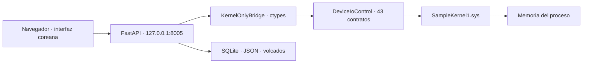
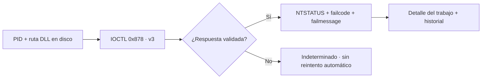

<div align="center">

# Kernel Based Process Memory Editor

**SampleKernel1 · Kernel Studio**<br>
Un espacio local para la memoria de procesos Windows, con un controlador de kernel.


[한국어](README.md) · [English](README.en.md) · [简体中文](README.zh-CN.md) · **Español**


[Inicio rápido](#inicio-rápido) · [Diagnóstico ManualV4](#diagnóstico-manualv4) · [Guía](docs/es/GUIDE.md) · [API / ABI](docs/reference/API_ABI.md)

</div>

> [!IMPORTANT]
> Esta actualización combina **controlador 2.6.0.1** y **panel 3.2.2**. ManualV4 usa el **paquete v3 de 2104 bytes**; los clientes v1/v2 son incompatibles. Compilar un `.sys` no sustituye al controlador que Windows ya tiene cargado.

## Del hexadecimal al trabajo diario

Seleccione un proceso, examine su memoria, reduzca candidatos y lleve una dirección al editor, Watch, herramientas PE o desensamblado. Kernel Studio conecta esos pasos en una interfaz web local.

La interfaz sigue en **coreano**. Estos documentos traducidos describen el mismo código y controles; no anuncian una aplicación traducida.

| Espacio | Funciones |
|---|---|
| Editor / gestión de memoria | Lecturas y escrituras tipadas, bytes, asignación, protección, copia y relleno |
| Escaneo / Watch | New → Next, AOB y cadenas, candidatos SQLite, direcciones guardadas y congelación |
| Imágenes / PE | Módulos, secciones, importaciones/IAT, exportaciones, pertenencia y PDB opcional |
| Desensamblado / estructuras | Instrucciones x86/x64, CFG, vista previa de parches, punteros y campos propios |
| Hilos / puntos de interrupción | Registros generales, suspensión/reanudación, prioridad y hardware breakpoints |
| Volcados / proyectos | Rangos grandes e imágenes mapeadas, progreso/cancelación, manifiestos y recuperación |
| ManualV4 | Mapeo DLL en kernel con estado, ubicación del fallo y diagnóstico detallado |

> [!TIP]
> «Seguramente es la dirección correcta» es una estrategia valiente. Revise los bytes y el proceso primero: su yo de mañana ya tendrá suficientes pestañas abiertas.

## El recorrido de una solicitud



Las lecturas, escrituras y consultas de regiones pasan por el controlador. En modo usuario se comparan bytes devueltos, gestionan candidatos y analizan PE/instrucciones. La conexión al dispositivo usa `CreateFileW`, `DeviceIoControl` y `CloseHandle`.

Los **43 contratos** abarcan `0x800`–`0x829` y ManualV4 `0x878`. El inventario completo está en la [referencia API / ABI](docs/reference/API_ABI.md), sin exigir una maratón de desplazamiento en la portada.

## Una vista del espacio de trabajo

| Editor de memoria | Escaneo de memoria |
|---|---|
|  |  |

*Capturas históricas del 2026-10-05–06, tomadas antes de elegir un proceso. Muestran la interfaz existente, no el nuevo diagnóstico ManualV4 de 3.2.2. Consulte la [procedencia de las imágenes](docs/images/README.md).*

## Inicio rápido

Use Windows x64, **Python de 64 bits**, herramientas C++ de Visual Studio 2022 y Windows SDK/WDK compatibles para compilar el controlador. La validación de desarrollo utilizó Python 3.14.5. [requirements.txt](kernel_control_panel/requirements.txt) establece rangos de dependencias, no un archivo de versiones bloqueadas.

Desde Developer PowerShell, en la raíz del repositorio:

```powershell
msbuild SampleKernel1.sln /t:Rebuild /m /p:Configuration=Release /p:Platform=x64 /p:SignMode=Off
```

La salida es `x64\Release\SampleKernel1.sys`. Este comando crea un controlador **sin firmar**; instalarlo/cargarlo requiere una configuración de firma y despliegue aceptada por su sistema de pruebas. Se entrega código fuente, no un instalador certificado WHQL. Véase la [guía](docs/es/GUIDE.md).

Inicie el panel desde el código fuente:

```powershell
cd kernel_control_panel
py -3 -m venv .venv
.\.venv\Scripts\Activate.ps1
python -m pip install -r requirements.txt
python kernel_studio.py
```

Abra **[http://127.0.0.1:8005/](http://127.0.0.1:8005/)**. `python server.py` usa el mismo puerto por defecto; `python kernel_studio.py --port 8006` permite otro. Ejecute un solo worker.

1. Compruebe la versión del **controlador cargado** en el panel.
2. Abra **대상 프로세스 선택** y elija su proceso de pruebas.
3. Lea una dirección conocida o busque un valor con New / Next.
4. Examine el resultado antes de escribir, congelar valores o modificar hilos.

> [!NOTE]
> La búsqueda de procesos sondea rangos PID con el contrato de consulta del kernel. No es una enumeración completa del sistema. Amplíe el rango o introduzca un PID si falta el proceso.

Para empaquetar el panel, active el entorno de compilación, instale PyInstaller y ejecute `tools\build_release.cmd` dentro de `kernel_control_panel`. Usa una carpeta nueva `dist/3.2.2/KernelStudio`, o un subdirectorio con fecha/hora si la versión ya existe, conservando paquetes y datos anteriores.

## Diagnóstico ManualV4

En **ManualV4**, introduzca la ruta absoluta de un DLL en disco, por ejemplo `C:\DLLs\Example.dll`. El panel vuelve a verificar la identidad del proceso justo antes de enviar PID y ruta al kernel.



| Campo | Significado |
|---|---|
| `ResultStatus` / NTSTATUS | Estado devuelto por la operación del kernel |
| `failcode` | `0` indica éxito; un número positivo identifica la rama del fallo |
| `failmessage[1024]` | Diagnóstico ANSI: hasta 1023 bytes ASCII, terminación NUL y cola de ceros |
| `MappedBase` / `EntryPoint` | Base y punto de entrada devueltos, mostrados como cadenas hexadecimales |

[manual_map_protocol.h](manual_map_protocol.h) define un único formato: `failcode` está en el desplazamiento **1076** y `failmessage` en **1080**. El primer diagnóstico se conserva aunque la limpieza cambie el estado final. Los mensajes demasiado largos terminan en `[truncated]`.

Por ejemplo, **failcode 119** identifica un fallo de `ZwProtectVirtualMemory` sobre una sección. Incluye nombre/índice, RVA, tamaños, protección solicitada, direcciones y NTSTATUS. Expone hechos observados: `ACCESS_DENIED` no demuestra por sí solo una causa concreta de política.

Las ramas de protección **117 / 118 / 119 / 123** también capturan:

- `pre_page`: estado/tipo/protección actual y de asignación, base, tamaño y cobertura de la primera región.
- `pre_dynamic`: Flags originales de código dinámico y sus bits decodificados.
- `pre_protection`: nivel, tipo, bit Audit y Signer de protección.

> [!IMPORTANT]
> Son **consultas de solo lectura antes de la llamada**. No establecen políticas, reducen permisos ni cambian los argumentos de protección. Una consulta fallida, no compatible o malformada es `UNAVAILABLE`, no «política desactivada». No es una instantánea atómica de un proceso activo.

> [!WARNING]
> El éxito HTTP o del transporte IOCTL no confirma un mapeo DLL correcto. Compruebe el estado validado del trabajo y el resultado del kernel. Un diagnóstico ausente/inválido pasa a `null` / indeterminado; el panel no repite el mapeo automáticamente.

Actualizar la lista solo consulta el estado. Para el flujo completo y sus límites, consulte la [guía](docs/es/GUIDE.md) y la [referencia del panel](kernel_control_panel/README_ko.md#manualv4-커널-매핑).

## Compilar, probar y entender la evidencia

Las últimas comprobaciones de desarrollo registraron **561 pruebas Python**, **8 grupos UI** y **2009 comprobaciones nativas en 135 ubicaciones de fallo**, además de compilaciones x64 Release/Debug y del panel. Son resultados de compilación/regresión, no prueba de todas las operaciones contra destinos reales en todas las versiones de Windows.

```powershell
# Desde la raíz: fixture de pruebas PE / PDB
powershell -NoProfile -ExecutionPolicy Bypass -File samples/build_fixture.ps1
cd kernel_control_panel
python -m unittest discover -p 'test*.py' -v
node test_manual_v4_ui.js
python native/manual_map/run_selftest.py
```

El harness nativo compila el **cuerpo actual del mapeador** con DDIs simuladas y solo adapta includes. No abre un controlador ni mapea un DLL en un proceso real. El discovery Python completo necesita el fixture DLL/PDB y el auxiliar DIA; véanse [samples](samples/README.md) y el [alcance de validación](docs/VALIDATION.md).

`test_driver_readonly.py` y `test_driver_all_ioctl.py` ejecutan los mismos siete diagnósticos de solo lectura al usarse explícitamente con un controlador cargado; el nombre del segundo no demuestra pruebas reales de las 43 operaciones.

## Límites prácticos

- x64 es el destino de desarrollo; las configuraciones ARM64 no garantizan compatibilidad.
- Varias lecturas de un proceso cambiante no forman una instantánea atómica.
- Los volcados de imágenes mapeadas conservan RVA; no reconstruyen archivos PE ejecutables en disco.
- Las escrituras, congelaciones, protecciones y operaciones de hilos cambian el estado real del destino.
- El panel fuente y el empaquetado usan raíces de datos distintas; véase la [guía](docs/es/GUIDE.md).

## Más detalles, menos búsqueda

| Documento | Contenido |
|---|---|
| [Guía de configuración y uso](docs/es/GUIDE.md) | Compilar, iniciar, seleccionar y resolver problemas |
| [API / ABI](docs/reference/API_ABI.md) | Contratos y formatos de paquetes |
| [Guía fuente del panel](kernel_control_panel/README_ko.md) | Funciones actuales en detalle, en coreano |
| [Workbench DLL](kernel_control_panel/DLL_WORKBENCH.md) | Imágenes, símbolos y llamadas |
| [Validación](docs/VALIDATION.md) | Evidencia de pruebas y límites |
| [Fixture](samples/README.md) | Reconstruir entradas DLL/PDB sintéticas |
| [Contribuciones](CONTRIBUTING.md) / [Seguridad](SECURITY.md) | Informes y flujo del repositorio |
| [Estado de licencia](LICENSE_STATUS.md) | No se asigna una licencia por cuenta del propietario |

Git no necesita paquetes generados del controlador/panel, volcados de usuarios, DLL/PDB subidos ni certificados de firma. Los binarios se generan localmente; aquí se conservan fuentes y soporte reproducible.
