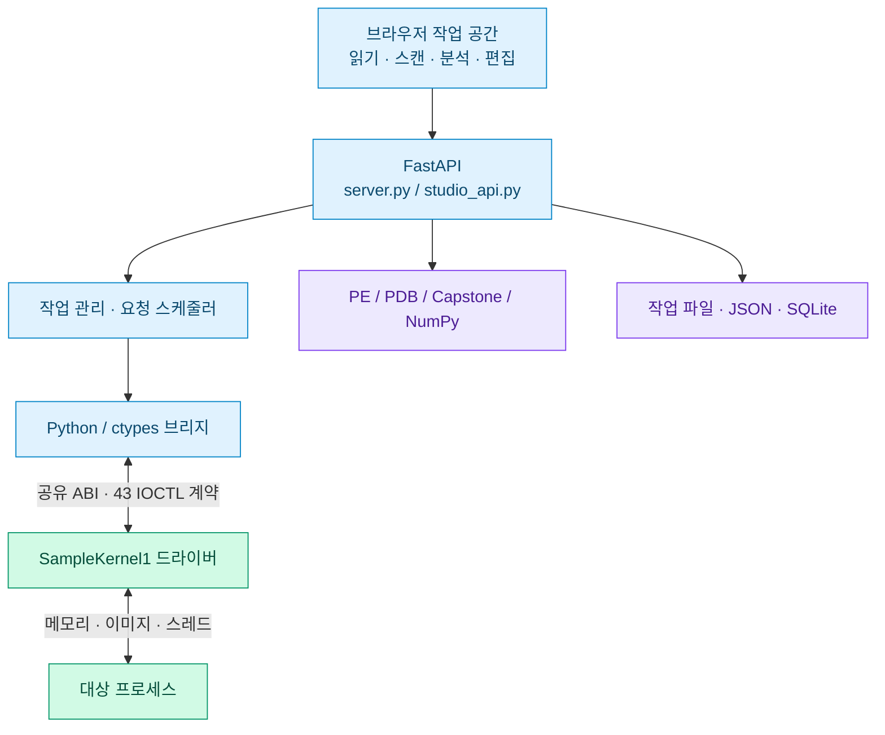
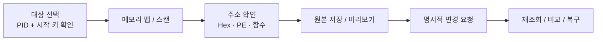
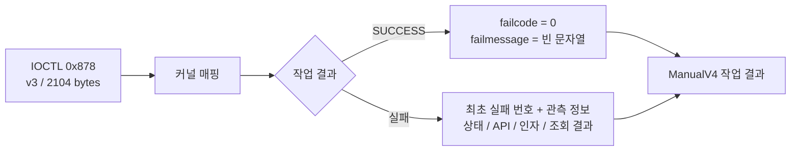

<div align="center">

# Kernel Studio

### Windows 커널에서 읽고, 작업 공간에서 이해하다.

**프로세스 메모리 · 스캔 · PE/PDB · 스레드 · 커널 매핑 진단**

[](driver_version.h)
[](kernel_control_panel/build_info.py)
[](#quick-start)
[](manual_map_protocol.h)
[](https://github.com/lastime1650/Kernel_Based_ProcessMemory_Editor/actions/workflows/regression.yml)

[한국어](README.md) · [English](README.en.md) · [简体中文](README.zh-CN.md) · [Español](README.es.md)


[빠른 시작](#quick-start) · [기능 둘러보기](#features) · [구조 이해하기](#architecture) · [실패 진단](#diagnostics) · [개발 문서](#documentation)

</div>

> **주소는 짧아도 이야기는 깁니다.** Kernel Studio는 그 이야기를 Hex, 그래프, 구조체, 그리고 오류 메시지로 펼쳐 놓습니다.

SampleKernel1 드라이버와 한국어 로컬 웹 패널을 함께 제공하는 Windows 프로세스 메모리 분석·편집 프로젝트입니다. Python 브리지가 공유 IOCTL 계약으로 드라이버와 통신하고, 반환된 바이트를 스캔·PE/PDB·디스어셈블리·비교·복구 작업으로 연결합니다.

> [!IMPORTANT]
> **현재 기준: 드라이버 `2.6.0.1` / 패널 `3.2.2` / 빌드 `20261012`.** ManualV4는 패킷 **v3 · 2104바이트**를 사용합니다. 이전 v1/v2 패널과 호환되지 않습니다. 화면의 드라이버 버전은 실제 로드된 장치가 응답한 버전입니다.

<a id="features"></a>

## 🧭 무엇을 할 수 있나요?

| 작업 공간 | 하는 일 | 이어지는 작업 |
|:--|:--|:--|
| 🔎 **메모리 스캔** | 값·AOB·문자열·Unknown/Next 검색, 후보 필터링 | 주소를 Hex / Watch / 분석 도구로 전달 |
| 🧩 **메모리 편집** | 형식별 읽기·쓰기, 포인터 체인, Wide View, 할당·보호 | 원본 확인 → 패치 → 비교·복구 |
| 🗂️ **이미지 분석** | PE 섹션·IAT·export, 모듈·함수 주소, 선택 PDB | 디스어셈블리·CFG·함수 분석 |
| 🧵 **스레드 도구** | 일반 레지스터 조회·편집, 하드웨어 중단점 | 컨텍스트 검증, 캡처·복원 정보 |
| 🏗️ **EPROCESS / 콜백** | 프로세스 객체 읽기·구조 탐색, 콜백 상태·등록·해제 | 빌드별 preset·범위·필드 확인 |
| 📦 **덤프 / 생산성** | 범위·MEM_IMAGE 덤프, 스냅샷·저널·시나리오·작업 큐 | manifest·SHA256, 취소·이어쓰기 |
| 🩺 **ManualV4** | PID와 디스크 DLL 경로를 커널에 전달 | NTSTATUS + failcode + failmessage |

**기술 스택:** C++ / WDK · Python / FastAPI · HTML / JavaScript · NumPy · Capstone · Keystone · DIA

> [!TIP]
> 처음에는 **대상 선택 → 메모리 맵 → 읽기 → 스캔 → 주소 분석** 순서로 둘러보세요. 주소 하나를 알아냈다면 다음 도구에 다시 타이핑할 필요가 없습니다. 손가락에도 캐시가 필요하니까요.

<details>
<summary><strong>📷 실제 화면 보기 — 기존 버전의 UI 참고 이미지</strong></summary>

아래 이미지는 이전 버전에서 촬영했습니다. 현재 화면·검증 결과로 취급하지 마세요. 최신 항목에는 ManualV4, EPROCESS, 콜백 도구 등이 추가되어 있습니다.

| 메모리 편집 | 메모리 스캔 |
|:--:|:--:|
| [](docs/images/02-memory-editor.jpg) | [](docs/images/03-memory-scan.jpg) |

[대시보드](docs/images/01-dashboard.jpg) · [디스어셈블리](docs/images/04-disassembly.jpg) · [이미지 출처](docs/images/README.md)

</details>

<a id="quick-start"></a>

## 🚀 빠른 시작

### 1. 소스 가져오기

```powershell
git clone https://github.com/lastime1650/Kernel_Based_ProcessMemory_Editor.git
cd Kernel_Based_ProcessMemory_Editor
```

### 2. 드라이버 빌드

**Visual Studio 2022 C++ 도구, Windows SDK, WDK**가 필요합니다. x64 Native Tools / Developer PowerShell에서:

```powershell
msbuild SampleKernel1.sln /t:Rebuild /p:Configuration=Release /p:Platform=x64 /p:SignMode=Off /m
```

결과는 `x64/Release/SampleKernel1.sys`입니다. `SignMode=Off` 결과물은 **서명되지 않은 빌드**입니다. 빌드 성공만으로 Windows의 드라이버 로드 요건을 충족하지는 않습니다. 드라이버 로드·서명은 사용하는 테스트 환경의 절차로 준비합니다.

### 3. 패널 실행

64비트 Python을 사용합니다. 현재 로컬 검증 환경은 Python 3.14이며, 의존성은 [requirements.txt](kernel_control_panel/requirements.txt)에 있습니다.

```powershell
cd kernel_control_panel
python -m venv .venv
.\.venv\Scripts\Activate.ps1
python -m pip install -r requirements.txt
python kernel_studio.py
```

**<http://127.0.0.1:8005/>**를 열고 대상 프로세스를 선택합니다. 포트 변경은 `python kernel_studio.py --port 8006`입니다.

> [!NOTE]
> 패널은 `127.0.0.1`에서 실행되고 화면 파일은 로컬에서 제공합니다. 드라이버가 연결되지 않으면 연결 상태와 기능 지원을 먼저 확인하세요. 새로 고침은 조회이며 변경 작업을 자동으로 반복하지 않습니다.

<details>
<summary><strong>📦 패널을 EXE로 패키징하기</strong></summary>

`kernel_control_panel`에서:

```powershell
python -m pip install pyinstaller
.\tools\build_release.cmd
```

새 출력은 `dist/3.2.2/KernelStudio/KernelStudio.exe`에 생성됩니다. 같은 버전 폴더가 있으면 그 아래 새 `build-<timestamp>` 폴더를 사용합니다. 실행 중인 기존 배포 폴더와 사용자 데이터는 보존합니다. 패키징은 드라이버 설치·로드를 수행하지 않습니다.

</details>

> [!WARNING]
> **ATTENTION — 메모리 쓰기는 실제 대상에 적용됩니다.** 분석 권한이 있는 테스트 프로세스와 환경에서 사용하세요. 커널의 작은 오타는 파란 화면으로 큰 발표를 할 수 있습니다. [보안 안내](SECURITY.md)와 [라이선스 상태](LICENSE_STATUS.md)를 확인하세요.

<a id="architecture"></a>

## 🏛️ 구조를 한 장으로



대상 메모리의 읽기·쓰기는 드라이버 IOCTL을 사용합니다. PE 해석·후보 비교·화면 구성은 반환된 자료를 바탕으로 유저 모드에서 수행합니다. 장치 연결 API와 별도 네이티브 분석 도구의 사용 범위는 [패널 안내](kernel_control_panel/README_ko.md)에 설명되어 있습니다.

### 읽은 주소가 작업으로 이어지는 흐름



> [!IMPORTANT]
> 여러 요청으로 읽은 데이터는 한 시점의 원자적 스냅샷이 아닙니다. 이미지 덤프는 메모리의 RVA 배치이며 디스크 PE를 복원한 실행 파일이 아닙니다. 읽지 못해 **0으로 채운 구간은 원본 데이터가 아닙니다.**

<a id="diagnostics"></a>

## 🩺 ManualV4: “실패했습니다”에서 한 걸음 더

**대상 선택 → DLL 절대 경로 입력 → 커널 매핑 요청 → 결과 확인.**

| 결과 필드 | 답하는 질문 | 읽는 방법 |
|:--|:--|:--|
| `ResultStatus` | 작업이 어떤 상태로 끝났나? | NTSTATUS 이름과 16진수 |
| `ULONG failcode` | 어디에서 실패했나? | `0`은 성공, `1..137`은 고유 실패 위치 |
| `char failmessage[1024]` | 그 지점에서 무엇을 관찰했나? | API·인자·주소·크기·상태와 진단 조회 |
| `MappedBase` / `EntryPoint` | 어떤 주소가 반환됐나? | 64비트 정밀도의 16진수 문자열 |



예를 들어 `119`는 섹션의 `ZwProtectVirtualMemory` 실패입니다. 메시지는 요청 주소·크기·보호 값, 섹션 정보와 NTSTATUS를 담습니다. `117 / 118 / 119 / 123`에는 보호 API 직전의 아래 조회 결과도 포함됩니다.

| 진단 | 포함하는 관측값 |
|:--|:--|
| `pre_page` | 첫 영역의 State · Type · Protect · AllocationProtect · 주소 · 크기 · 요청 범위 포함 여부 |
| `pre_dynamic` | 동적 코드 정책의 원시 Flags와 4개 정책 비트 |
| `pre_protection` | 보호 레벨 · Type · Audit · Signer |

> [!NOTE]
> 조회는 **읽기 전용 진단**이며 매핑 알고리즘이나 요청 보호 값을 바꾸지 않습니다. 조회 불가·미지원·잘못된 응답은 `UNAVAILABLE`이며, “정책이 꺼짐”으로 해석하지 않습니다. 페이지 조회는 첫 영역과 해당 시점을 설명합니다.

> [!IMPORTANT]
> **IOCTL 전송 성공 ≠ DLL 매핑 성공.** 패널은 유효한 응답과 `ResultStatus == 0`, 유효한 Base를 확인합니다. 전송·응답이 불확실하면 진단은 `null`/미확인이며 자동 재매핑하지 않습니다. `ACCESS_DENIED` 하나만으로 내부 거절 원인을 확정할 수는 없습니다.

메시지는 ANSI에서 동일하게 해석되는 ASCII 영문·숫자를 사용합니다. 최대 1023바이트와 NUL 종료이며 초과 시 ` [truncated]`를 표시합니다. 최초 실패 진단은 정리 과정에서도 유지합니다. **failcode는 현장 번호, failmessage는 현장 메모입니다. 추리 소설의 범인 발표는 아닙니다.**

→ [공유 프로토콜과 실패 위치](manual_map_protocol.h) · [커널 구현](MANUAL_KERNEL.hpp) · [ABI 상세](docs/reference/API_ABI.md)

## 🧪 검증과 재현

| 검증 종류 | 현재 로컬 결과 | 확인하는 범위 |
|:--|:--|:--|
| 드라이버 x64 Release / Debug | 재빌드 통과 | 컴파일·링크·INF/카탈로그, 서명 제외 |
| Python 회귀 | 561개 통과 | 모의 전송·분석·작업·진단 계약 |
| ManualV4 UI | 8개 그룹 통과 | 표시·상태·진단·재요청 방지 |
| 네이티브 매퍼 harness | 2009 checks / 135 실패 위치 | 현재 커널 코드 + 모의 DDI |

<details>
<summary><strong>재현 명령 펼치기</strong></summary>

저장소 루트에서 PE/PDB 시험 자료를 먼저 생성합니다. 시험 DLL을 대상 프로세스에 로드하지 않습니다.

```powershell
.\samples\build_fixture.ps1
cd kernel_control_panel
.\native\build_pdb_symbols.cmd
python -m unittest discover -p 'test*.py' -v
node test_manual_v4_ui.js
python native/manual_map/run_selftest.py
```

나머지 UI 시험과 CI 구성은 [검증 문서](docs/VALIDATION.md)에 있습니다. 로컬 결과와 CI 실행 결과는 별개의 기록입니다.

</details>

> [!NOTE]
> 모의 시험과 빌드 통과는 모든 Windows 버전·프로세스의 실제 실행을 보장하지 않습니다. CI는 드라이버를 설치하거나 로드하지 않습니다. 실제 정책 집행과 대상 동작은 테스트 환경에서 별도로 확인해야 합니다.

<a id="documentation"></a>

## 📚 길을 잃지 않는 소스 지도

```text
SampleKernel1.sln                 드라이버 솔루션
main.cpp / ioctl_helper.hpp      수명 주기와 IOCTL 디스패치
helper.hpp / utils.hpp           메모리·이미지·스레드 보조 구현
MANUAL_KERNEL.hpp               커널 수동 매핑과 실패 진단
*_protocol.h                    공유 요청 계약
kernel_control_panel/
  kernel_studio.py / server.py   로컬 패널 진입점
  driver_bridge.py              ctypes / IOCTL 브리지
  manual_v4.py / static/        작업 상태와 브라우저 UI
  native/ / tools/ / presets/   네이티브 시험·패키징·구조 preset
samples/                        재현 가능한 PE/PDB 시험 자료 소스
docs/                           구조·검증·API/ABI 참고 자료
```

| 읽고 싶은 것 | 문서 |
|:--|:--|
| 화면별 사용법과 실제 제한 | [패널 사용 안내](kernel_control_panel/README_ko.md) |
| 파일별 구현 위치 | [소스 지도](docs/SOURCE_MAP.md) |
| IOCTL·구조체·HTTP 계약 | [API / ABI 참고](docs/reference/API_ABI.md) |
| 회귀 시험과 검증 범위 | [검증 안내](docs/VALIDATION.md) |
| 기능과 버전 변화 | [변경 이력](CHANGELOG.md) |
| EPROCESS / 이미지 / 스캔 / 디스어셈블리 | [문서 모음](docs/README.md) |

프로젝트 소스·설정·시험·문서를 추적합니다. IDE 캐시, 생성 바이너리, 개인 덤프·PDB·실행 DB, 서명 키는 추적하지 않습니다. 현재 프로젝트 라이선스는 지정되지 않았습니다. [기여 안내](CONTRIBUTING.md) · [보안 안내](SECURITY.md) · [지원](SUPPORT.md) · [라이선스 상태](LICENSE_STATUS.md)
