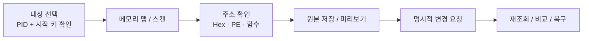

<div align="center">

# Kernel Studio

### Windows 커널에서 읽고, 작업 공간에서 이해하다.

**프로세스 · 메모리 · 검색 · 이미지 분석 · 스레드 · 작업 공간**

[](driver_version.h)
[](kernel_control_panel/build_info.py)
[](#quick-start)
[](manual_map_protocol.h)
[](https://github.com/lastime1650/Kernel_Based_ProcessMemory_Editor/actions/workflows/regression.yml)

[한국어](README.md) · [English](README.en.md) · [简体中文](README.zh-CN.md) · [Español](README.es.md)


[빠른 시작](#quick-start) · [네비게이션별 기능](#features) · [구조](#architecture) · [개발 문서](#documentation)

</div>

> **주소는 짧아도 이야기는 깁니다.** Kernel Studio는 그 이야기를 Hex, 그래프, 구조체, 그리고 오류 메시지로 펼쳐 놓습니다.

SampleKernel1 드라이버와 한국어 로컬 웹 패널을 함께 제공하는 Windows 프로세스 메모리 분석·편집 프로젝트입니다. Python 브리지가 공유 IOCTL 계약으로 드라이버와 통신하고, 반환된 바이트를 스캔·PE/PDB·디스어셈블리·비교·복구 작업으로 연결합니다.

> [!IMPORTANT]
> **현재 기준: 드라이버 `2.6.0.2` / 패널 `3.2.3` / 빌드 `20261017`.** ManualV4는 패킷 **v3 · 2104바이트**를 사용합니다. 이전 v1/v2 패널과 호환되지 않습니다. 화면의 드라이버 버전은 실제 로드된 장치가 응답한 버전입니다.

<a id="features"></a>

## 🧭 네비게이션별 기능 안내

아래 항목은 패널 사이드바 순서에 맞춰 각 화면의 역할을 하나씩 정리했습니다. 메뉴 이름은 실제 한국어 UI와 같습니다.

| 네비게이션 | 기능 |
|---|---|
| **대시보드** | 드라이버 연결 상태, 선택한 대상, 최근 작업을 한눈에 확인합니다. |
| **구조체 / 클래스** | 사용자 정의 메모리 구조의 필드와 오프셋을 정의하고 읽습니다. |
| **프로젝트 작업 공간** | 분석 설정과 주소, 스캔 상태를 프로젝트로 보관하고 복구합니다. |
| **변경 기록 / 묶음** | 변경 항목을 묶어 메모와 함께 기록하고 다시 살펴봅니다. |
| **변화 타임라인** | 선택한 값과 바이트를 시간에 따라 기록하고 두 시점을 비교합니다. |
| **프로세스 / 권한** | 프로세스 정보와 토큰·핸들·관련 스레드를 조회합니다. |
| **EPROCESS 구조체** | 버전별 레이아웃을 기준으로 커널 프로세스 객체의 필드를 살펴봅니다. |
| **메모리 편집** | 선택한 주소를 여러 데이터 형식과 바이트 단위로 읽고 편집합니다. |
| **읽기 / 쓰기 / 덤프** | 주소 범위의 원시 메모리 요청과 바이트 덤프를 수행합니다. |
| **메모리 할당** | 대상 프로세스의 메모리 영역을 할당하고 결과 주소를 확인합니다. |
| **메모리 관리** | 할당·해제·보호·복사·채우기와 메모리 스냅샷을 관리합니다. |
| **메모리 스캔** | 값·패턴·AOB·문자열 검색으로 후보 주소를 좁힙니다. |
| **Watch / 값 고정** | 관심 주소의 값을 추적하고 필요할 때 고정하거나 해제합니다. |
| **모듈 / PE / 주소** | 모듈·영역, PE 섹션·Import·Export와 주소 소속을 확인합니다. |
| **메모리 / 이미지 덤프** | 메모리 범위나 이미지 단위 덤프의 진행 상태와 결과를 확인합니다. |
| **메모리 맵 변화** | 메모리 영역 표본을 저장하고 시간에 따른 차이를 비교합니다. |
| **스레드 / 레지스터** | 스레드와 일반 레지스터를 조회하고 컨텍스트·우선순위 등을 관리합니다. |
| **APC_NORMALIZE** | 선택한 스레드에 User APC 루틴, 컨텍스트와 두 시스템 인자를 요청합니다. |
| **하드웨어 중단점** | 스레드 하드웨어 중단점을 설정·조회·삭제합니다. |
| **스냅샷 / 패치 / 분석** | 스냅샷 비교·복구, 패치 미리보기·적용·되돌리기와 포인터·구조 분석을 제공합니다. |
| **디스어셈블리** | 메모리의 x86/x64 명령을 표시하고 제어 흐름을 분석합니다. |
| **DLL / 이미지 함수** | 이미지 Export·함수와 PDB 정보를 연결해 함수 주소와 상세를 살펴봅니다. |
| **ManualV4** | Windows 파일 선택창에서 DLL 절대경로를 받아 직접 커널에 전달하고, 매핑만 수행 옵션과 결과를 확인합니다. |
| **ManualV4_Viewer** | 성공한 매핑의 시작 주소를 검증한 뒤 PDB 함수 주소와 매개변수를 분석합니다. |
| **ObRegisterCallback Panel** | 드라이버 전역 Object Callback의 상태를 확인하고 등록·해제합니다. |
| **작업 큐 / 시나리오** | JSON 시나리오와 묶음 요청을 큐에 넣고 진행 결과를 확인합니다. |
| **호출 이력 / 기능** | 드라이버 상태와 추적된 함수 호출의 결과를 살펴봅니다. |
| **메모리 Wide View (Beta)** | 메모리 맵과 주변 바이트·관측 변화를 넓은 화면으로 탐색합니다. |

**기술 스택:** C++ / WDK · Python / FastAPI · HTML / JavaScript · NumPy · Capstone · Keystone · DIA

> [!TIP]
> 처음에는 **대상 선택 → 메모리 맵 → 읽기 → 스캔 → 주소 분석** 순서로 둘러보세요. 주소 하나를 알아냈다면 다음 도구에 다시 타이핑할 필요가 없습니다. 손가락에도 캐시가 필요하니까요.

<details>
<summary><strong>📷 실제 화면 보기 — 기존 버전의 UI 참고 이미지</strong></summary>

아래 이미지는 이전 UI를 촬영한 참고 자료이며 현재 화면 구성이나 검증 결과를 나타내지 않습니다.

| 메모리 편집 | 메모리 스캔 |
|:--:|:--:|
| [](docs/images/02-memory-editor.jpg) | [](docs/images/03-memory-scan.jpg) |

[대시보드](docs/images/01-dashboard.jpg) · [디스어셈블리](docs/images/04-disassembly.jpg) · [이미지 출처](docs/images/README.md)

</details>

<a id="quick-start"></a>

## 🚀 빠른 시작

### 1. 소스 가져오기

```powershell
git clone https://github.com/lastime1650/Kernel_Based_ProcessMemory_Editor.git
cd Kernel_Based_ProcessMemory_Editor
```

### 2. 드라이버 빌드

**Visual Studio 2022 C++ 도구, Windows SDK, WDK**가 필요합니다. x64 Native Tools / Developer PowerShell에서:

```powershell
msbuild SampleKernel1.sln /t:Rebuild /p:Configuration=Release /p:Platform=x64 /p:SignMode=Off /m
```

결과는 `x64/Release/SampleKernel1.sys`입니다. `SignMode=Off` 결과물은 **서명되지 않은 빌드**입니다. 빌드 성공만으로 Windows의 드라이버 로드 요건을 충족하지는 않습니다. 드라이버 로드·서명은 사용하는 테스트 환경의 절차로 준비합니다.

### 3. 패널 실행

64비트 Python을 사용합니다. 현재 로컬 검증 환경은 Python 3.14이며, 의존성은 [requirements.txt](kernel_control_panel/requirements.txt)에 있습니다.

```powershell
cd kernel_control_panel
python -m venv .venv
.\.venv\Scripts\Activate.ps1
python -m pip install -r requirements.txt
python kernel_studio.py
```

**<http://127.0.0.1:8005/>**를 열고 대상 프로세스를 선택합니다. 포트 변경은 `python kernel_studio.py --port 8006`입니다.

> [!NOTE]
> 패널은 `127.0.0.1`에서 실행되고 화면 파일은 로컬에서 제공합니다. 드라이버가 연결되지 않으면 연결 상태와 기능 지원을 먼저 확인하세요. 새로 고침은 조회이며 변경 작업을 자동으로 반복하지 않습니다.

<details>
<summary><strong>📦 패널을 EXE로 패키징하기</strong></summary>

`kernel_control_panel`에서:

```powershell
python -m pip install pyinstaller
.\tools\build_release.cmd
```

새 출력은 `dist/3.2.3/KernelStudio/KernelStudio.exe`에 생성됩니다. 같은 버전 폴더가 있으면 그 아래 새 `build-<timestamp>` 폴더를 사용합니다. 실행 중인 기존 배포 폴더와 사용자 데이터는 보존합니다. 패키징은 드라이버 설치·로드를 수행하지 않습니다.

</details>

> [!WARNING]
> **ATTENTION — 메모리 쓰기는 실제 대상에 적용됩니다.** 분석 권한이 있는 테스트 프로세스와 환경에서 사용하세요. 커널의 작은 오타는 파란 화면으로 큰 발표를 할 수 있습니다. [보안 안내](SECURITY.md)와 [라이선스 상태](LICENSE_STATUS.md)를 확인하세요.

<a id="architecture"></a>

## 🏛️ 구조를 한 장으로


대상 메모리의 읽기·쓰기는 드라이버 IOCTL을 사용합니다. PE 해석·후보 비교·화면 구성은 반환된 자료를 바탕으로 유저 모드에서 수행합니다. 장치 연결 API와 별도 네이티브 분석 도구의 사용 범위는 [패널 안내](kernel_control_panel/README_ko.md)에 설명되어 있습니다.

### 읽은 주소가 작업으로 이어지는 흐름



> [!IMPORTANT]
> 여러 요청으로 읽은 데이터는 한 시점의 원자적 스냅샷이 아닙니다. 이미지 덤프는 메모리의 RVA 배치이며 디스크 PE를 복원한 실행 파일이 아닙니다. 읽지 못해 **0으로 채운 구간은 원본 데이터가 아닙니다.**

## 🧪 검증과 재현

| 검증 종류 | 현재 로컬 결과 | 확인하는 범위 |
|:--|:--|:--|
| 드라이버 x64 Release / Debug | 재빌드 통과 | 컴파일·링크·INF/카탈로그, 서명 제외 |
| Python 회귀 | 561개 통과 | 모의 전송·분석·작업·진단 계약 |
| ManualV4 UI | 8개 그룹 통과 | 표시·상태·진단·재요청 방지 |
| 네이티브 매퍼 harness | 2009 checks / 135 실패 위치 | 현재 커널 코드 + 모의 DDI |

<details>
<summary><strong>재현 명령 펼치기</strong></summary>

저장소 루트에서 PE/PDB 시험 자료를 먼저 생성합니다. 시험 DLL을 대상 프로세스에 로드하지 않습니다.

```powershell
.\samples\build_fixture.ps1
cd kernel_control_panel
.\native\build_pdb_symbols.cmd
python -m unittest discover -p 'test*.py' -v
node test_manual_v4_ui.js
python native/manual_map/run_selftest.py
```

나머지 UI 시험과 CI 구성은 [검증 문서](docs/VALIDATION.md)에 있습니다. 로컬 결과와 CI 실행 결과는 별개의 기록입니다.

</details>

> [!NOTE]
> 모의 시험과 빌드 통과는 모든 Windows 버전·프로세스의 실제 실행을 보장하지 않습니다. CI는 드라이버를 설치하거나 로드하지 않습니다. 실제 정책 집행과 대상 동작은 테스트 환경에서 별도로 확인해야 합니다.

<a id="documentation"></a>

## 📚 길을 잃지 않는 소스 지도

```text
SampleKernel1.sln                 드라이버 솔루션
main.cpp / ioctl_helper.hpp      수명 주기와 IOCTL 디스패치
helper.hpp / utils.hpp           메모리·이미지·스레드 보조 구현
MANUAL_KERNEL.hpp               커널 수동 매핑과 실패 진단
*_protocol.h                    공유 요청 계약
kernel_control_panel/
  kernel_studio.py / server.py   로컬 패널 진입점
  driver_bridge.py              ctypes / IOCTL 브리지
  manual_v4.py / static/        작업 상태와 브라우저 UI
  native/ / tools/ / presets/   네이티브 시험·패키징·구조 preset
samples/                        재현 가능한 PE/PDB 시험 자료 소스
docs/                           구조·검증·API/ABI 참고 자료
```

| 읽고 싶은 것 | 문서 |
|:--|:--|
| 화면별 사용법과 실제 제한 | [패널 사용 안내](kernel_control_panel/README_ko.md) |
| 파일별 구현 위치 | [소스 지도](docs/SOURCE_MAP.md) |
| IOCTL·구조체·HTTP 계약 | [API / ABI 참고](docs/reference/API_ABI.md) |
| 회귀 시험과 검증 범위 | [검증 안내](docs/VALIDATION.md) |
| 기능과 버전 변화 | [변경 이력](CHANGELOG.md) |
| EPROCESS / 이미지 / 스캔 / 디스어셈블리 | [문서 모음](docs/README.md) |

프로젝트 소스·설정·시험·문서를 추적합니다. IDE 캐시, 생성 바이너리, 개인 덤프·PDB·실행 DB, 서명 키는 추적하지 않습니다. 현재 프로젝트 라이선스는 지정되지 않았습니다. [기여 안내](CONTRIBUTING.md) · [보안 안내](SECURITY.md) · [지원](SUPPORT.md) · [라이선스 상태](LICENSE_STATUS.md)
