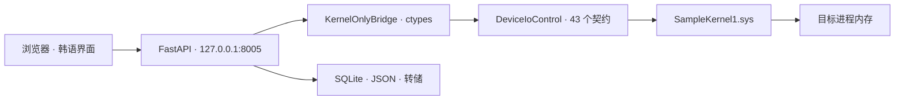
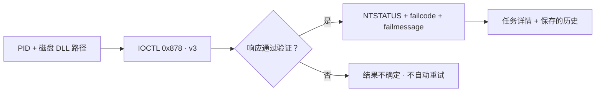

<div align="center">

# Kernel Based Process Memory Editor

**SampleKernel1 · Kernel Studio**<br>
由内核驱动支持的 Windows 进程内存本地工作台。


[한국어](README.md) · [English](README.en.md) · **简体中文** · [Español](README.es.md)


[快速开始](#快速开始) · [ManualV4 诊断](#manualv4-诊断) · [使用指南](docs/zh-CN/GUIDE.md) · [API / ABI](docs/reference/API_ABI.md)

</div>

> [!IMPORTANT]
> 当前源码对应 **驱动 2.6.0.1** 和 **面板 3.2.2**。ManualV4 使用 **v3、2104 字节**的数据包，与 v1/v2 客户端不兼容。重新生成 `.sys` 不会自动替换 Windows 中已加载的驱动。

## 把地址变成工作流程

选择进程、查看内存、逐步缩小扫描候选，再将地址传给编辑器、Watch、PE 工具或反汇编。Kernel Studio 在本地浏览器中连接这些步骤。

应用界面仍为**韩语**。中文文档说明相同源码和控件，并不表示程序已提供中文界面。

| 工作区 | 提供的功能 |
|---|---|
| 内存编辑 / 管理 | 按类型读写、字节编辑、分配、保护属性、复制和填充 |
| 扫描 / Watch | New → Next 扫描、AOB 和字符串、SQLite 候选、保存地址与数值冻结 |
| 映像 / PE | 模块、节、导入/IAT、导出、地址归属及可选 PDB 符号 |
| 反汇编 / 结构体 | x86/x64 指令、CFG、补丁预览、指针链及自定义字段 |
| 线程 / 断点 | 通用寄存器、暂停/恢复、优先级及硬件断点管理 |
| 转储 / 项目 | 大范围及映射映像转储、进度/取消、清单与恢复记录 |
| ManualV4 | 内核 DLL 映射、操作状态、失败位置及详细诊断 |

> [!TIP]
> “这个地址应该没错”很有冒险精神。先预览字节并确认目标进程吧——明天的你已经有够多标签页要收拾了。

## 请求如何到达目标



目标读写和内存区域查询通过驱动完成。用户态比较返回的字节、管理扫描候选并解析 PE/指令。设备连接使用 `CreateFileW`、`DeviceIoControl` 和 `CloseHandle`。

**43 个请求契约**覆盖 `0x800`–`0x829` 和 ManualV4 的 `0x878`。完整清单见 [API / ABI 参考](docs/reference/API_ABI.md)，无需在首页参加滚动马拉松。

## 工作区预览

| 内存编辑器 | 内存扫描 |
|---|---|
|  |  |

*截图来自 2026-10-05–06，拍摄时尚未选择目标。它们展示原有界面，不包含 3.2.2 新增的 ManualV4 诊断。详见[图片来源](docs/images/README.md)。*

## 快速开始

使用 Windows x64、**64 位 Python**；构建驱动还需要 Visual Studio 2022 C++ 工具及兼容的 Windows SDK/WDK。开发验证使用 Python 3.14.5。[requirements.txt](kernel_control_panel/requirements.txt) 指定依赖范围，并非锁定文件。

在仓库根目录的 Developer PowerShell 中运行：

```powershell
msbuild SampleKernel1.sln /t:Rebuild /m /p:Configuration=Release /p:Platform=x64 /p:SignMode=Off
```

输出为 `x64\Release\SampleKernel1.sys`。此命令生成**未签名**驱动；安装和加载需要测试系统接受的签名与部署配置。仓库提供源码，并非经过 WHQL 认证的安装包。详见[安装指南](docs/zh-CN/GUIDE.md)。

从源码启动面板：

```powershell
cd kernel_control_panel
py -3 -m venv .venv
.\.venv\Scripts\Activate.ps1
python -m pip install -r requirements.txt
python kernel_studio.py
```

打开 **[http://127.0.0.1:8005/](http://127.0.0.1:8005/)**。`python server.py` 使用相同默认端口；`python kernel_studio.py --port 8006` 可指定其他端口。只运行一个服务器 worker。

1. 在仪表盘确认**已加载驱动**的版本。
2. 打开 **대상 프로세스 선택**，选择自己的测试目标。
3. 读取已知地址，或用 New / Next 查找数值。
4. 应用写入、冻结或线程修改前先检查结果。

> [!NOTE]
> 进程发现通过现有内核查询契约探测 PID 范围，不是完整的系统枚举。列表缺少目标时可扩大范围或手动输入 PID。

打包面板时，激活构建环境、安装 PyInstaller，并在 `kernel_control_panel` 中运行 `tools\build_release.cmd`。它写入新的 `dist/3.2.2/KernelStudio`；版本目录已存在时创建带时间戳的子目录，保留之前的软件包和数据。

## ManualV4 诊断

在 **ManualV4** 中输入磁盘 DLL 的绝对路径，例如 `C:\DLLs\Example.dll`。面板在将 PID 和路径发送给内核前重新检查进程身份。



| 字段 | 含义 |
|---|---|
| `ResultStatus` / NTSTATUS | 内核操作返回的状态 |
| `failcode` | 成功为 `0`；正整数标识失败分支 |
| `failmessage[1024]` | ANSI 诊断：最多 1023 个 ASCII 字节、NUL 结束、尾部填零 |
| `MappedBase` / `EntryPoint` | 返回的映像基址和入口点；显示为十六进制字符串 |

[manual_map_protocol.h](manual_map_protocol.h) 统一定义数据包布局：`failcode` 偏移 **1076**，`failmessage` 偏移 **1080**。即使清理阶段改变最终操作状态，仍保留首次失败诊断。超过空间的消息以 `[truncated]` 结尾。

例如，**failcode 119** 标识某个节的 `ZwProtectVirtualMemory` 失败。消息包括节名/索引、RVA、大小、请求保护属性、地址和 NTSTATUS。它报告观测事实；仅凭 `ACCESS_DENIED` 不能确定具体策略原因。

保护分支 **117 / 118 / 119 / 123** 还会捕获：

- `pre_page`：首个区域的状态、类型、当前/分配保护属性、基址、大小及请求覆盖范围。
- `pre_dynamic`：动态代码策略原始 Flags 与解码后的位。
- `pre_protection`：保护级别、类型、Audit 位和 Signer。

> [!IMPORTANT]
> 这些是**调用前的只读查询**，不设置策略、不放宽权限、不改变原保护调用参数。失败、不支持或格式错误的查询显示 `UNAVAILABLE`，不能解读为“策略关闭”。目标正在变化时，这不是原子快照。

> [!WARNING]
> HTTP 请求成功或 IOCTL 传输成功，并不代表 DLL 映射成功。应检查已验证的任务状态和内核结果。缺失或无效诊断显示为 `null` / 不确定，面板不会自动重新映射。

刷新任务列表只读取状态。完整操作流程及限制见[使用指南](docs/zh-CN/GUIDE.md)与[面板参考](kernel_control_panel/README_ko.md#manualv4-커널-매핑)。

## 构建、测试与验证范围

最近的开发验证记录了 **561 个 Python 测试**、**8 组 UI 测试**、**2009 项原生检查（覆盖 135 个失败位置）**，以及 x64 Release/Debug 和面板构建。这些是构建与回归结果，不表示所有操作已在每个 Windows 版本的真实目标上测试。

```powershell
# 在仓库根目录：构建 PE / PDB 测试样例
powershell -NoProfile -ExecutionPolicy Bypass -File samples/build_fixture.ps1
cd kernel_control_panel
python -m unittest discover -p 'test*.py' -v
node test_manual_v4_ui.js
python native/manual_map/run_selftest.py
```

原生映射测试仅调整 include，将**当前映射器函数体**与模拟 DDI 一同编译。它不打开驱动、不向真实进程映射 DLL。完整 Python discovery 需要 DLL/PDB 样例及 DIA 辅助程序；见[样例说明](samples/README.md)和[验证范围](docs/VALIDATION.md)。

显式配合已加载驱动运行时，`test_driver_readonly.py` 和 `test_driver_all_ioctl.py` 执行相同的七个只读诊断；后者的名称不代表对全部 43 个操作进行了真实测试。

## 实际限制

- x64 是当前开发支持目标；ARM64 配置不等于兼容性保证。
- 多个请求读取正在变化的进程，不构成原子快照。
- 映射映像转储保持 RVA 布局，不会重建可执行的磁盘 PE 文件。
- 写入、冻结、保护属性和线程操作会改变目标的实际状态。
- 源码面板与打包面板的数据根目录不同，详见[指南](docs/zh-CN/GUIDE.md)。

## 进一步阅读

| 文档 | 内容 |
|---|---|
| [安装与使用指南](docs/zh-CN/GUIDE.md) | 构建、启动、选择目标与故障排查 |
| [API / ABI](docs/reference/API_ABI.md) | 请求契约及数据包布局 |
| [面板源码指南](kernel_control_panel/README_ko.md) | 当前功能的详细韩语说明 |
| [DLL 工作台](kernel_control_panel/DLL_WORKBENCH.md) | 映像、符号与函数调用 |
| [验证](docs/VALIDATION.md) | 测试证据及边界 |
| [测试样例](samples/README.md) | 重新构建合成 DLL/PDB 输入 |
| [贡献](CONTRIBUTING.md) / [安全](SECURITY.md) | 问题报告与仓库工作流程 |
| [许可证状态](LICENSE_STATUS.md) | 不代替所有者指定许可证 |

Git 不需要包含生成的驱动/面板软件包、用户转储、上传的 DLL/PDB 或签名证书。构建产物留在本地，源码及可复现的辅助文件保存在仓库。
