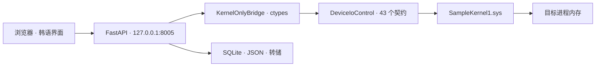

<div align="center">

# Kernel Based Process Memory Editor

**SampleKernel1 · Kernel Studio**<br>
由内核驱动支持的 Windows 进程内存本地工作台。


[한국어](README.md) · [English](README.en.md) · **简体中文** · [Español](README.es.md)


[快速开始](#快速开始) · [按导航浏览功能](#features) · [使用指南](docs/zh-CN/GUIDE.md) · [API / ABI](docs/reference/API_ABI.md)

</div>

> [!IMPORTANT]
> 当前源码对应 **驱动 2.6.0.2** 和 **面板 3.2.3**。ManualV4 使用 **v3、2104 字节**的数据包，与 v1/v2 客户端不兼容。重新生成 `.sys` 不会自动替换 Windows 中已加载的驱动。

<a id="features"></a>

## 按导航逐项了解功能

下表按面板侧边栏顺序列出各页面；括号中的韩文名称与应用界面一致。

| 导航 | 功能 |
|---|---|
| **대시보드 (仪表盘)** | 查看驱动连接、所选目标和最近的工作区状态。 |
| **구조체 / 클래스 (结构体 / 类)** | 定义并查看自定义内存布局的字段与偏移。 |
| **프로젝트 작업 공간 (项目工作区)** | 将分析设置、地址和扫描状态保存为项目并恢复。 |
| **변경 기록 / 묶음 (变更记录 / 分组)** | 将变更项目分组、添加备注并回顾。 |
| **변화 타임라인 (变化时间线)** | 按时间记录选定的值和字节，并比较两个样本。 |
| **프로세스 / 권한 (进程 / 权限)** | 查看进程信息、令牌、句柄及相关线程。 |
| **EPROCESS 구조체 (EPROCESS 结构体)** | 依据不同版本的布局查看内核进程对象字段。 |
| **메모리 편집 (内存编辑)** | 按数据类型或单个字节读取和编辑所选地址。 |
| **읽기 / 쓰기 / 덤프 (读取 / 写入 / 转储)** | 发送原始内存请求并转储指定范围的字节。 |
| **메모리 할당 (内存分配)** | 在所选进程中分配区域并查看返回地址。 |
| **메모리 관리 (内存管理)** | 管理分配、释放、保护、复制、填充和内存快照。 |
| **메모리 스캔 (内存扫描)** | 通过数值、模式、AOB 和字符串搜索缩小候选地址。 |
| **Watch / 값 고정 (监视 / 冻结)** | 跟踪监视地址，并冻结或解除冻结其数值。 |
| **모듈 / PE / 주소 (模块 / PE / 地址)** | 查看模块、区域、PE 节、导入、导出和地址归属。 |
| **메모리 / 이미지 덤프 (内存 / 映像转储)** | 查看范围转储和映像转储的进度与结果。 |
| **메모리 맵 변화 (内存映射变化)** | 保存内存区域映射并比较不同时间的样本。 |
| **스레드 / 레지스터 (线程 / 寄存器)** | 查看线程和通用寄存器，并管理上下文与优先级。 |
| **APC_NORMALIZE** | 为所选线程请求 User APC 例程，并传递上下文和两个系统参数。 |
| **하드웨어 중단점 (硬件断点)** | 按线程设置、查询和移除硬件断点。 |
| **스냅샷 / 패치 / 분석 (快照 / 补丁 / 分析)** | 比较或恢复快照、预览/应用/撤销补丁，并分析指针或结构体。 |
| **디스어셈블리 (反汇编)** | 显示内存中的 x86/x64 指令并检查控制流。 |
| **DLL / 이미지 함수 (DLL / 映像函数)** | 关联映像导出和 PDB 符号，查看函数地址与详情。 |
| **ManualV4** | 请求内核映射 DLL，可选择跳过 DllMain，并查看内核结果。 |
| **ManualV4_Viewer** | 验证成功映射的基址后，查看 PDB 函数地址和参数。 |
| **ObRegisterCallback Panel** | 查看、注册和注销驱动全局 Object Callback。 |
| **작업 큐 / 시나리오 (任务队列 / 场景)** | 排队运行 JSON 场景和组合请求，并查看进度。 |
| **호출 이력 / 기능 (调用历史 / 功能)** | 查看驱动状态和受跟踪的函数调用结果。 |
| **메모리 Wide View (Beta) (内存宽视图)** | 在宽视图中探索内存映射、邻近字节和观测到的变化。 |

> [!TIP]
> “这个地址应该没错”很有冒险精神。先预览字节并确认目标进程吧——明天的你已经有够多标签页要收拾了。

## 请求如何到达目标



目标读写和内存区域查询通过驱动完成。用户态比较返回的字节、管理扫描候选并解析 PE/指令。设备连接使用 `CreateFileW`、`DeviceIoControl` 和 `CloseHandle`。

**44 个请求契约**覆盖 `0x800`–`0x829`、ManualV4 的 `0x878` 和 APC_NORMALIZE 的 `0x900`。完整清单见 [API / ABI 参考](docs/reference/API_ABI.md)，无需在首页参加滚动马拉松。

## 工作区预览

| 内存编辑器 | 内存扫描 |
|---|---|
|  |  |

*截图拍摄于 2026-10-05–06，当时尚未选择目标。它们仅供界面参考，并未完整展示当前导航或验证结果。详见[图片来源](docs/images/README.md)。*

## 快速开始

使用 Windows x64、**64 位 Python**；构建驱动还需要 Visual Studio 2022 C++ 工具及兼容的 Windows SDK/WDK。开发验证使用 Python 3.14.5。[requirements.txt](kernel_control_panel/requirements.txt) 指定依赖范围，并非锁定文件。

在仓库根目录的 Developer PowerShell 中运行：

```powershell
msbuild SampleKernel1.sln /t:Rebuild /m /p:Configuration=Release /p:Platform=x64 /p:SignMode=Off
```

输出为 `x64\Release\SampleKernel1.sys`。此命令生成**未签名**驱动；安装和加载需要测试系统接受的签名与部署配置。仓库提供源码，并非经过 WHQL 认证的安装包。详见[安装指南](docs/zh-CN/GUIDE.md)。

从源码启动面板：

```powershell
cd kernel_control_panel
py -3 -m venv .venv
.\.venv\Scripts\Activate.ps1
python -m pip install -r requirements.txt
python kernel_studio.py
```

打开 **[http://127.0.0.1:8005/](http://127.0.0.1:8005/)**。`python server.py` 使用相同默认端口；`python kernel_studio.py --port 8006` 可指定其他端口。只运行一个服务器 worker。

1. 在仪表盘确认**已加载驱动**的版本。
2. 打开 **대상 프로세스 선택**，选择自己的测试目标。
3. 读取已知地址，或用 New / Next 查找数值。
4. 应用写入、冻结或线程修改前先检查结果。

> [!NOTE]
> 进程发现通过现有内核查询契约探测 PID 范围，不是完整的系统枚举。列表缺少目标时可扩大范围或手动输入 PID。

打包面板时，激活构建环境、安装 PyInstaller，并在 `kernel_control_panel` 中运行 `tools\build_release.cmd`。它写入新的 `dist/3.2.3/KernelStudio`；版本目录已存在时创建带时间戳的子目录，保留之前的软件包和数据。

## 构建、测试与验证范围

最近的开发验证记录了 **561 个 Python 测试**、**8 组 UI 测试**、**2009 项原生检查（覆盖 135 个失败位置）**，以及 x64 Release/Debug 和面板构建。这些是构建与回归结果，不表示所有操作已在每个 Windows 版本的真实目标上测试。

```powershell
# 在仓库根目录：构建 PE / PDB 测试样例
powershell -NoProfile -ExecutionPolicy Bypass -File samples/build_fixture.ps1
cd kernel_control_panel
python -m unittest discover -p 'test*.py' -v
node test_manual_v4_ui.js
python native/manual_map/run_selftest.py
```

原生映射测试仅调整 include，将**当前映射器函数体**与模拟 DDI 一同编译。它不打开驱动、不向真实进程映射 DLL。完整 Python discovery 需要 DLL/PDB 样例及 DIA 辅助程序；见[样例说明](samples/README.md)和[验证范围](docs/VALIDATION.md)。

显式配合已加载驱动运行时，`test_driver_readonly.py` 和 `test_driver_all_ioctl.py` 执行相同的七个只读诊断；后者的名称不代表对全部 43 个操作进行了真实测试。

## 实际限制

- x64 是当前开发支持目标；ARM64 配置不等于兼容性保证。
- 多个请求读取正在变化的进程，不构成原子快照。
- 映射映像转储保持 RVA 布局，不会重建可执行的磁盘 PE 文件。
- 写入、冻结、保护属性和线程操作会改变目标的实际状态。
- 源码面板与打包面板的数据根目录不同，详见[指南](docs/zh-CN/GUIDE.md)。

## 进一步阅读

| 文档 | 内容 |
|---|---|
| [安装与使用指南](docs/zh-CN/GUIDE.md) | 构建、启动、选择目标与故障排查 |
| [API / ABI](docs/reference/API_ABI.md) | 请求契约及数据包布局 |
| [面板源码指南](kernel_control_panel/README_ko.md) | 当前功能的详细韩语说明 |
| [DLL 工作台](kernel_control_panel/DLL_WORKBENCH.md) | 映像、符号与函数调用 |
| [验证](docs/VALIDATION.md) | 测试证据及边界 |
| [测试样例](samples/README.md) | 重新构建合成 DLL/PDB 输入 |
| [贡献](CONTRIBUTING.md) / [安全](SECURITY.md) | 问题报告与仓库工作流程 |
| [许可证状态](LICENSE_STATUS.md) | 不代替所有者指定许可证 |

Git 不需要包含生成的驱动/面板软件包、用户转储、上传的 DLL/PDB 或签名证书。构建产物留在本地，源码及可复现的辅助文件保存在仓库。
