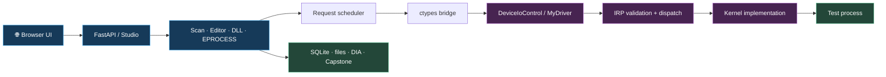

# 🧭 소스 지도 · Source map

[문서 홈](README.md) · [API / ABI](reference/API_ABI.md) · [검증 기록](VALIDATION.md)

**드라이버 2.6.0.1 · Kernel Studio 3.2.2 · 2026-10-12 동기화**

> [!NOTE]
> 공개 저장소에는 현재 프로젝트의 소스·테스트·빌드 설정을 담습니다. 실행 기록, 대상 데이터, 빌드 산출물은 제외합니다. 파일별 현재 원본 대조값은 [SHA-256 목록](reference/SOURCE_SHA256.tsv)에 있습니다.

## 한눈에 보는 실행 흐름

## 커널과 공유 프로토콜

| 파일 | 찾아볼 내용 |
|---|---|
| [main.cpp](../main.cpp) | 드라이버 진입, 장치·심볼릭 링크, IRP, 종료 및 rundown |
| [ioctl_helper.hpp](../ioctl_helper.hpp) | 기본 IOCTL 식별자, 패킷 검증, 요청 디스패치 |
| [helper.hpp](../helper.hpp) | 프로세스·메모리·스레드·중단점 구현과 자원 수명 |
| [MANUAL_KERNEL.hpp](../MANUAL_KERNEL.hpp) | PE 검사, 이미지 구성, 재배치, IAT, 보호 적용, DllMain, 실패 진단 |
| [manual_map_protocol.h](../manual_map_protocol.h) | ManualV4 v3, 2104-byte 요청·응답, failcode 정의, 1024-byte failmessage |
| [remote_call.hpp](../remote_call.hpp) · [remote_call_protocol.h](../remote_call_protocol.h) | 장치 파일 소유 함수 호출 기록과 create/query/release ABI |
| [ob_callbacks.hpp](../ob_callbacks.hpp) · [ob_callbacks_protocol.h](../ob_callbacks_protocol.h) | Ob observer 등록·해제·상태와 V2 ABI |
| [helper/process_object_layouts.h](../helper/process_object_layouts.h) | 지원 OS 빌드의 EPROCESS 읽기 범위 |
| [utils.hpp](../utils.hpp) | 공통 커널 보조 코드 |
| [driver_client.hpp](../driver_client.hpp) · [test_client.cpp](../test_client.cpp) | 별도 C++ 클라이언트 |
| [driver_version.h](../driver_version.h) · [driver_version.rc](../driver_version.rc) | IOCTL 버전과 PE 파일 버전 |
| [SampleKernel1.vcxproj](../SampleKernel1.vcxproj) · [SampleKernel1.inf](../SampleKernel1.inf) | 드라이버 빌드·패키징 설정 |

빌드 프로젝트는 `main.cpp`를 컴파일하고 헤더 구현을 포함합니다. 프로젝트 설정은 KMDF를 선언하지만 장치·IRP 진입은 WDM 스타일로 직접 구현합니다. `routine.cpp`는 현재 프로젝트의 컴파일 대상이 아닌 이전 예제입니다.

## 패널에서 기능 찾기

| 영역 | Python 구현 | 화면 코드 |
|---|---|---|
| 실행·버전·패키징 | [kernel_studio.py](../kernel_control_panel/kernel_studio.py), [build_info.py](../kernel_control_panel/build_info.py), [runtime_paths.py](../kernel_control_panel/runtime_paths.py) | [index.html](../kernel_control_panel/static/index.html), [studio.js](../kernel_control_panel/static/studio.js), [studio.css](../kernel_control_panel/static/studio.css) |
| 서버·작업·세션 | [server.py](../kernel_control_panel/server.py), [studio_api.py](../kernel_control_panel/studio_api.py), [request_scheduler.py](../kernel_control_panel/request_scheduler.py) | 공통 Studio UI |
| 장치 연결·ABI | [driver_bridge.py](../kernel_control_panel/driver_bridge.py), [kernel_only_bridge.py](../kernel_control_panel/kernel_only_bridge.py) | 상태·기능 표시 |
| ManualV4 | [manual_v4.py](../kernel_control_panel/manual_v4.py), [manual_map_protocol.py](../kernel_control_panel/manual_map_protocol.py) | [manual_v4.js](../kernel_control_panel/static/manual_v4.js) |
| EPROCESS | [eprocess_workbench.py](../kernel_control_panel/eprocess_workbench.py), [presets](../kernel_control_panel/presets/eprocess) | [eprocess_workspace.js](../kernel_control_panel/static/eprocess_workspace.js) |
| Ob callbacks | [ob_callbacks_protocol.py](../kernel_control_panel/ob_callbacks_protocol.py), `studio_api.py` | [ob_callbacks.js](../kernel_control_panel/static/ob_callbacks.js) |
| 검색 | [scan_workspace.py](../kernel_control_panel/scan_workspace.py), [kernel_scanner.py](../kernel_control_panel/kernel_scanner.py) | [scan_workspace.js](../kernel_control_panel/static/scan_workspace.js) |
| 메모리 편집·할당·덤프 | [memory_editor.py](../kernel_control_panel/memory_editor.py), [memory_allocation.py](../kernel_control_panel/memory_allocation.py), [memory_dump.py](../kernel_control_panel/memory_dump.py), [memory_wide_view.py](../kernel_control_panel/memory_wide_view.py) | 해당 이름의 `static/*.js`·`*.css` |
| DLL·PE·기호 | [image_workbench.py](../kernel_control_panel/image_workbench.py), [memory_images.py](../kernel_control_panel/memory_images.py), [public_symbols.py](../kernel_control_panel/public_symbols.py) | [dll_workspace.js](../kernel_control_panel/static/dll_workspace.js) |
| 명령·함수 분석 | [disassembly_workspace.py](../kernel_control_panel/disassembly_workspace.py), [function_views.py](../kernel_control_panel/function_views.py), [function_inference.py](../kernel_control_panel/function_inference.py), [decompiler_metadata.py](../kernel_control_panel/decompiler_metadata.py), [function_semantics.py](../kernel_control_panel/function_semantics.py), [c_expressions.py](../kernel_control_panel/c_expressions.py), [api_prototypes.py](../kernel_control_panel/api_prototypes.py) | [disassembly_workspace.js](../kernel_control_panel/static/disassembly_workspace.js), [function_views.js](../kernel_control_panel/static/function_views.js) |
| HWBP 수집 | [hwbp_capture.py](../kernel_control_panel/hwbp_capture.py), [native/hwbp_capture](../kernel_control_panel/native/hwbp_capture) | Studio capture 도구 |
| 기록·구조체·프로젝트 | [change_journal.py](../kernel_control_panel/change_journal.py), [atomic_metadata.py](../kernel_control_panel/atomic_metadata.py), [productivity_suite.py](../kernel_control_panel/productivity_suite.py), [process_catalog.py](../kernel_control_panel/process_catalog.py), [studio_extensions.py](../kernel_control_panel/studio_extensions.py) | [productivity_suite.js](../kernel_control_panel/static/productivity_suite.js) |

> [!TIP]
> “이 버튼의 실제 코드는 어디 있지?”가 시작점이라면 `static/*.js`의 요청 경로 → `studio_api.py`의 action → 기능 모듈 → `driver_bridge.py` 순서로 따라가세요. 커널은 마지막 역이고, 실수는 첫 역에서도 탑승할 수 있습니다. 🚉

## 진단과 회귀 시험

| 위치 | 범위 |
|---|---|
| [test*.py](../kernel_control_panel) | 모의 장치 응답, ABI·세션·동시성·PE·PDB·상태 검증 |
| [test_manual_v4_ui.js](../kernel_control_panel/test_manual_v4_ui.js) | ManualV4 모의 DOM 회귀 8개 그룹 |
| [test_ob_callbacks_ui.js](../kernel_control_panel/test_ob_callbacks_ui.js), EPROCESS·PDB UI tests | 해당 기능의 DOM·응답·오래된 요청 검증 |
| [native/manual_map](../kernel_control_panel/native/manual_map) | 현재 커널 매퍼 본문을 mock DDIs에 연결하는 C++ 시험 |
| [native/pdb_symbols.cpp](../kernel_control_panel/native/pdb_symbols.cpp) | DIA 기반 로컬 PDB 분석 보조 실행 파일 |
| [samples](../samples/README.md) | 테스트가 사용하는 DLL/PDB를 소스에서 재현 |
| [.github/workflows/regression.yml](../.github/workflows/regression.yml) | Windows Python·DOM·네이티브 모의 회귀 CI |

## 구현 경계

- 활성 검색 서버는 커널 검색 경로를 사용합니다. `memory_scanner.py`의 이전 Win32 검색은 현재 서버의 대상 접근 경로가 아닙니다.
- `0x820` 스레드 종료는 커널·브리지에 있지만 웹 UI에서 제외됩니다. `0x817/0x818` 이벤트 요청은 비활성 호환 응답입니다.
- ManualV4, 원격 함수 호출, 기존 DLL 등록은 서로 다른 경로입니다. 상세 ABI와 실행 의미는 [API / ABI](reference/API_ABI.md)를 확인하세요.
- NT 내부 구조·루틴과 OS별 EPROCESS 레이아웃에 의존합니다. x64 로컬 검증을 ARM64 또는 모든 Windows 빌드 검증으로 확대 해석하지 않습니다.

**English:** Sources, tests and build configuration are synchronized to driver **2.6.0.1** and panel **3.2.2**. Tables link directly to implementation. Current-source integrity is recorded in the SHA-256 manifest; build artifacts and local runtime data are excluded. CI uses mocked target access, while DIA analyzes a locally built fixture.
