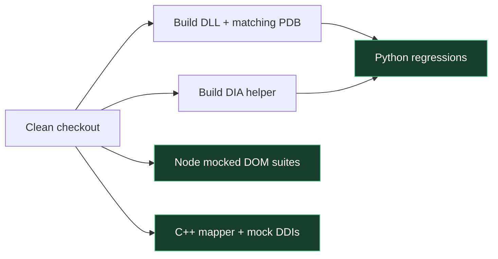

# 🧪 검증 기록 · Validation

[문서 홈](README.md) · [소스 지도](SOURCE_MAP.md) · [API / ABI](reference/API_ABI.md)

**기준: 드라이버 2.6.0.1 / Kernel Studio 3.2.2 · 2026-10-12 (Asia/Seoul)**

> [!IMPORTANT]
> 아래 결과는 로컬 검증 기록입니다. GitHub CI 성공 여부는 [실제 실행 기록](https://github.com/lastime1650/Kernel_Based_ProcessMemory_Editor/actions/workflows/regression.yml)에서 별도로 확인하세요. 모의 시험 통과는 실제 대상에서의 드라이버 로드·DLL 매핑 성공을 보증하지 않습니다.

## 최신 로컬 결과

| 검증 | 결과 | 무엇을 확인했나 |
|---|---|---|
| Python unittest discovery | ✅ **561 tests** | 브리지 응답, 프로토콜, 워크스페이스, PE/PDB, 동시성 등 |
| ManualV4 UI | ✅ **8 mock regression groups** | 성공·실패·불명 응답, 문자열 표시, 이력과 UI 상태 |
| Native manual-map harness | ✅ **2009 checks / 135 failure locations** | 현재 매퍼 본문 + 모의 커널 DDIs; ABI·실패·보호 직전 진단 |
| x64 Release rebuild | ✅ | 원본 프로젝트, INF/catalog 포함; `SignMode=Off` |
| x64 Debug rebuild | ✅ | 원본 프로젝트, INF/catalog 포함; `SignMode=Off` |
| Panel 3.2.2 packaging | ✅ | 실행 파일 버전, help 실행, 번들 모듈·정적 리소스와 소스 일치 |
| Manual map wire contract | ✅ | v3 / 2104 bytes / failcode@1076 / failmessage@1080 |

`failcode`는 1–138을 정의하지만 위에 기록된 네이티브 시험에서 독립적으로 유발한 위치는 **135개**입니다. 코드 `20`과 `137`은 앞선 원인을 보존하는 보충 fallback이며, 이후 추가된 `138` (`OnlyMapping` 입력 검증)은 해당 기록의 시험 범위에 포함되지 않습니다.

이번 버전의 로컬 검증 환경은 Windows x64, Python 3.14.5, Visual Studio 2022 Professional, SDK 10.0.26100.0, WDK 10.0.26100.6584입니다. 실제 드라이버 재로드나 실제 프로세스에 대한 매핑은 이 회귀 검증에서 수행하지 않았습니다.

## 깨끗한 체크아웃에서 재현

Python 의존성, Visual Studio C++ 도구, DIA SDK, Node.js가 필요합니다. 전체 discovery 전에 **DIA 보조 도구와 저장소 안의 DLL/PDB fixture**를 빌드하세요. 일부 기존 테스트는 fixture가 없으면 개발자의 외부 경로로 fallback하므로 이 순서가 중요합니다.

```powershell
# Repository root: build the source fixture, without loading it.
powershell -NoProfile -ExecutionPolicy Bypass -File samples/build_fixture.ps1

cd kernel_control_panel/native
.\build_pdb_symbols.cmd
cd ..

python -m pip install -r requirements.txt
python -m unittest discover -p 'test*.py' -v

# Five standalone mocked DOM suites; ManualV4 reports eight groups.
$sourceArguments = @{
    'test_eprocess_workspace_ui.js' = 'static/eprocess_workspace.js'
    'test_process_object_ui.js' = 'static/studio.js'
}
Get-ChildItem -File -Filter 'test*_ui.js' | Sort-Object Name | ForEach-Object {
    if ($sourceArguments.ContainsKey($_.Name)) {
        node $_.FullName $sourceArguments[$_.Name]
    } else {
        node $_.FullName
    }
    if ($LASTEXITCODE -ne 0) { throw "UI regression failed: $($_.Name)" }
}

# Entire current MANUAL_KERNEL.hpp body; includes adapted, DDIs mocked.
python native/manual_map/run_selftest.py --output build/manual_map-selftest
```

`build_pdb_symbols.cmd`의 DIA 경로는 VS 2022 Professional을 기준으로 합니다. 다른 에디션을 쓰면 자신의 설치 경로로 맞추세요. CI는 설치된 VS 2022 C++ 경로를 찾아 호환 junction으로 해결합니다. native manual-map runner는 `vswhere`로 도구를 찾습니다.

드라이버 빌드는 WDK가 있는 개발 환경에서 별도로 실행합니다.

```powershell
msbuild SampleKernel1.sln /t:Rebuild /m /p:Configuration=Release /p:Platform=x64 /p:SignMode=Off
msbuild SampleKernel1.sln /t:Rebuild /m /p:Configuration=Debug /p:Platform=x64 /p:SignMode=Off
```

## CI 범위



CI는 DLL fixture를 **컴파일하고 분석**합니다. 대상에 로드하거나 내보낸 함수를 호출하지 않습니다. Python discovery와 DOM 시험은 대상 접근을 모의 구현으로 대체합니다. native harness는 사용자 모드 실행 파일에서 커널 DDIs를 모의 구현으로 연결하며 실제 드라이버 핸들을 열지 않습니다. WDK 드라이버 빌드와 드라이버 서명·로드는 이 워크플로의 범위 밖입니다.

> [!NOTE]
> `test_driver_readonly.py`를 직접 실행하면 실제 로드된 드라이버를 조회합니다. `test_driver_all_ioctl.py`도 현재는 이 7개 읽기 전용 진단의 호환 진입점입니다. 이름만 보고 “모든 IOCTL 실전 검증 완료” 도장을 찍지는 않습니다. 도장은 예쁘지만 증거는 더 예쁩니다. 🧾

## 진단 결과의 한계

- `failcode`는 실패 위치, `NTSTATUS`는 API 결과입니다. `failmessage`는 당시 인자와 관찰값을 추가합니다.
- 보호 직전 페이지·정책·프로세스 보호 조회는 읽기 전용의 시점별 snapshot입니다. 상태를 고정하거나 요청 성공 원인을 확정하지 않습니다.
- 조회 불가·반환 크기 불일치·잘못된 payload는 `UNAVAILABLE`로 남습니다. 값 `0`이나 “정책 해제”로 바꾸지 않습니다.
- 1024-byte 버퍼가 가득 차면 ` [truncated]`를 남길 수 있습니다. 성공에서는 메시지 전체가 0이고, 실패에서는 첫 원인을 보존합니다.
- 로컬 unsigned 빌드 결과는 공개 배포 서명이나 모든 Windows 빌드·ARM64 호환 인증이 아닙니다.

**English:** Latest local evidence is **561 Python tests**, **8 ManualV4 UI groups**, **2009 native checks covering 135 distinct failure locations**, and unsigned x64 Release/Debug rebuilds. The workflow reproduces mocked regressions plus real PE/PDB fixture analysis; it neither loads a driver nor maps a DLL into a real target. Check the actual Actions run before claiming remote CI passed.
