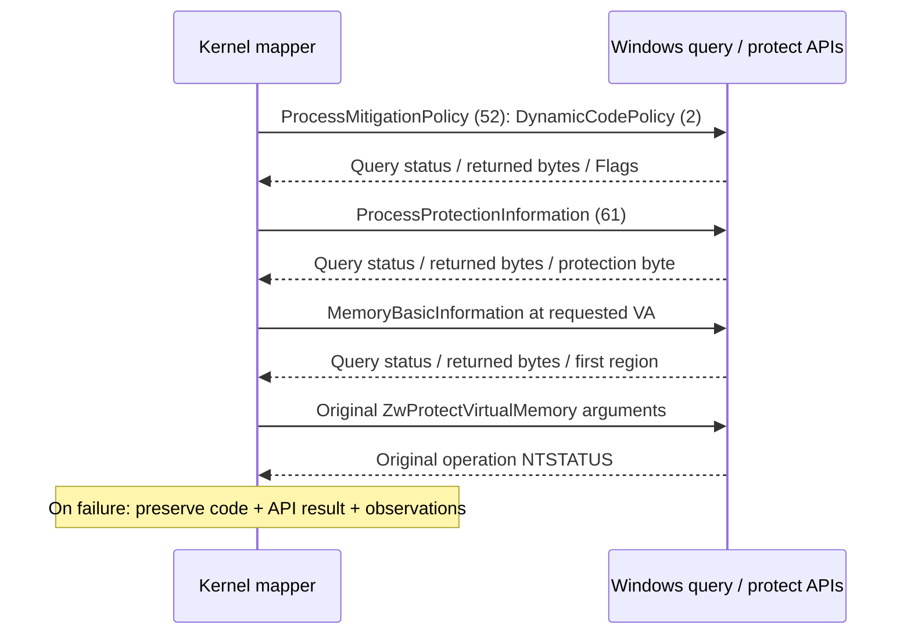

# 🔌 HTTP API / IOCTL ABI

[문서 홈](../README.md) · [소스 지도](../SOURCE_MAP.md) · [검증](../VALIDATION.md)

**Driver 2.6.0.1 · Kernel Studio 3.2.2**

| 현재 소스에서 확인한 목록 | 수 |
|---|---:|
| HTTP / WebSocket route decorators | **82** |
| IOCTL identifiers | **43** |
| 직접 정의된 ctypes wire layouts¹ | **46** |
| 위 layouts의 직접 fields¹ | **355** |

¹ `driver_bridge.py`, `manual_map_protocol.py`, `ob_callbacks_protocol.py` 기준입니다. 중첩 보조 구조와 별도의 HWBP ring 데이터는 포함하지 않습니다.

> [!IMPORTANT]
> `DeviceIoControl` 전송 성공과 작업의 `ResultStatus` 성공은 별개입니다. ManualV4에서는 응답 전체의 길이·버전·요청 echo·주소·failcode·failmessage를 함께 검증합니다. 불명 응답을 성공으로 바꾸거나 자동 재호출하지 않습니다.

## ManualV4: 정확한 v3 wire layout

[커널·C++ 공유 헤더](../../manual_map_protocol.h) · [Python 계약](../../kernel_control_panel/manual_map_protocol.py) · [브리지 검증](../../kernel_control_panel/driver_bridge.py#L1337) · [UI 작업·이력](../../kernel_control_panel/manual_v4.py)

- Function **`0x878`** · complete IOCTL **`0x0022E1E0`**
- `METHOD_BUFFERED`, read + write access, **pack=1**
- **Version=3 · total 2104 bytes · UTF-16 ImagePath[520]**
- v1/v2 요청 크기를 재사용하지 않습니다. 드라이버와 패널을 함께 업데이트하세요.

| Field | Offset | Bytes | 계약 |
|---|---:|---:|---|
| `Version` | 0 | 4 | 입력 3 |
| `Reserved` | 4 | 4 | 입력 0 |
| `ProcessId` | 8 | 8 | 대상 PID |
| `ImagePath` | 16 | 1040 | NUL 종료 NT disk path, WCHAR 520개 |
| `ResultStatus` | 1056 | 4 | 작업 NTSTATUS |
| `MappedBase` | 1060 | 8 | 입력 0; 응답 이미지 기준 주소 |
| `EntryPoint` | 1068 | 8 | 입력 0; 응답 진입점 |
| `failcode` | **1076** | 4 | 입력 0; 성공 0, 실패 위치 1–137 |
| `failmessage` | **1080** | **1024** | 입력 모두 0; 실패 ANSI 호환 문자열 |

### 실패 문자열의 계약

`failcode`는 실행한 분기 개수가 아니라 **첫 최종 실패 위치의 고정 번호**입니다. 복구 가능한 할당·검색 시도는 이 번호를 먼저 소비하지 않습니다. 전체 이름은 [MKM_FAIL_CODE](../../manual_map_protocol.h#L17)에 있습니다.

| 코드 | 영역 |
|---|---|
| 1–11 | IOCTL 요청 검증 |
| 12–20 | 매핑 준비·대상·범위·flush·cleanup |
| 21–26 | 파일 읽기 |
| 27–49 | PE headers 및 지원 조건 |
| 50–53 | 로컬 이미지 구성 |
| 54–71 | API-set namespace 및 attach |
| 72–79 | 대상 모듈·export 문자열 |
| 80–97 | export 해석·forwarder |
| 98–107 | IAT |
| 108–114 | 재배치 |
| 115–116 | 원격 할당·쓰기 |
| **117 / 118 / 119** | **전체 이미지 / headers / section 보호 적용** |
| 120–136 | DllMain 준비·스레드·관찰·정리 (`123`: stub 보호) |
| 137 | 최종 실패 fallback |

- 커널 출력은 ASCII 기반으로 ANSI 호환성을 유지합니다. 최대 **1023 bytes + NUL**이고 NUL 뒤 남은 bytes는 모두 0입니다.
- 성공이면 `ResultStatus=0`, `failcode=0`, `failmessage` 전체가 0입니다. 실패면 첫 코드와 메시지를 보존하고 최종 operation status를 추가할 수 있습니다.
- 공간 부족 시 ` [truncated]` 표시가 붙습니다. 경로나 뒷부분은 잘릴 수 있습니다.
- 패널은 raw 1024 bytes의 NUL, ASCII 범위, zero tail을 검사합니다. 손상·짧은 전송·불일치 응답의 `failcode`와 `failmessage`는 `None`이며 작업은 불명 상태로 처리합니다.
- 오래된 저장 이력의 메시지 누락도 `None`입니다. 화면 출력은 escape합니다.

> [!NOTE]
> `119`는 section 보호 API가 실패했다는 위치 정보입니다. `STATUS_ACCESS_DENIED`와 페이지·정책 snapshot만으로 특정 Windows 정책을 원인으로 단정하지 않습니다. failmessage는 현장 기록자이며, 판사는 아닙니다. 🕵️

### 보호 API 직전 관찰값

이미지, headers, section, DllMain stub의 네 보호 위치에 같은 읽기 전용 조회를 적용합니다.

| 진단 부분 | 기록 |
|---|---|
| API·요청 | handle, 입력 VA·size·protect, 보호 의미, NTSTATUS |
| Section (`119`) | index·name·RVA·VirtualSize·RawSize·span·Characteristics |
| API 출력 | output VA·size·old protect; 실패의 old protect는 `untrusted_on_failure` |
| `pre_page` | query status·length, State·Type·Protect·AllocationProtect, Base·AllocationBase·RegionSize |
| 페이지 범위 | `first_region_only=1`, page-rounded 요청이 첫 region에 포함되는지 |
| `pre_dynamic` | query status·length, Flags, ProhibitDynamicCode·AllowThreadOptOut·AllowRemoteDowngrade·AuditProhibitDynamicCode |
| `pre_protection` | query status·length, Level·Type·Audit·Signer |

조회 불가, 잘못된 반환 길이·selector·range는 `UNAVAILABLE`로 표시합니다. MEM_FREE/MEM_RESERVE에서 의미 없는 속성은 `UNDEFINED`로 구분합니다. 이 조회는 프로세스 정책이나 보호 값을 설정하지 않으며 원래 보호 API의 인자·실패 반환을 유지합니다. snapshot은 조회 시점의 관찰값이므로 보호 호출과 원자적으로 묶인 상태가 아닙니다.

ManualV4는 매핑 직전에 PID와 시작 키를 확인하지만 이 wire ABI에는 시작 키 필드가 없습니다. 확인 후 PID 교체를 커널 요청과 원자적으로 차단한다고 주장하지 않습니다. 실패 중 원격 이미지가 유지되는 경우나 timeout·불명 응답에서는 실행 여부를 별도로 확인해야 합니다.

## 전체 IOCTL 식별자

`CTL_CODE(FILE_DEVICE_UNKNOWN, function, METHOD_BUFFERED, FILE_READ_ACCESS | FILE_WRITE_ACCESS)`

Function ID와 완성된 IOCTL 값을 구분하세요. `0x878`과 `0x0022E1E0`는 같은 요청의 서로 다른 표기입니다.

| Function | Full IOCTL | Python identifier | Scope |
|---|---|---|---|
| `0x800` | `0x0022E000` | `IOCTL_HELPER_PROCESS_INFORMATION` | 연결 / Connected |
| `0x801` | `0x0022E004` | `IOCTL_HELPER_ALLOC_VIRTUAL_MEMORY` | 연결 / Connected |
| `0x802` | `0x0022E008` | `IOCTL_HELPER_FREE_VIRTUAL_MEMORY` | 연결 / Connected |
| `0x803` | `0x0022E00C` | `IOCTL_HELPER_COPY_PROCESS_MEMORY` | 연결 / Connected |
| `0x804` | `0x0022E010` | `IOCTL_HELPER_SCAN_VALUE_PROCESS` | 연결 / Connected |
| `0x805` | `0x0022E014` | `IOCTL_HELPER_READ_PROCESS` | 연결 / Connected |
| `0x806` | `0x0022E018` | `IOCTL_HELPER_READ_STRING_PROCESS` | 연결 / Connected |
| `0x807` | `0x0022E01C` | `IOCTL_HELPER_READ_PROCESS_INFORMATION` | 연결 / Connected |
| `0x808` | `0x0022E020` | `IOCTL_HELPER_FREE_LINKED_LIST` | 연결 / Connected |
| `0x809` | `0x0022E024` | `IOCTL_HELPER_FREE_STRING_LIST` | 연결 / Connected |
| `0x80A` | `0x0022E028` | `IOCTL_HELPER_SET_HARDWARE_BREAKPOINT` | 연결 / Connected |
| `0x80B` | `0x0022E02C` | `IOCTL_HELPER_QUERY_HARDWARE_BREAKPOINT` | 연결 / Connected |
| `0x80C` | `0x0022E030` | `IOCTL_HELPER_REMOVE_HARDWARE_BREAKPOINT` | 연결 / Connected |
| `0x80D` | `0x0022E034` | `IOCTL_HELPER_FREE_HARDWARE_BREAKPOINT_RESULT` | 연결 / Connected |
| `0x80E` | `0x0022E038` | `IOCTL_HELPER_REGISTER_DLL` | 연결 / Connected |
| `0x80F` | `0x0022E03C` | `IOCTL_HELPER_WRITE_PROCESS` | 연결 / Connected |
| `0x810` | `0x0022E040` | `IOCTL_HELPER_PROTECT_VIRTUAL_MEMORY` | 연결 / Connected |
| `0x811` | `0x0022E044` | `IOCTL_HELPER_PATTERN_SCAN` | 연결 / Connected |
| `0x812` | `0x0022E048` | `IOCTL_HELPER_ENUMERATE_THREADS` | 연결 / Connected |
| `0x813` | `0x0022E04C` | `IOCTL_HELPER_SUSPEND_THREAD` | 연결 / Connected |
| `0x814` | `0x0022E050` | `IOCTL_HELPER_RESUME_THREAD` | 연결 / Connected |
| `0x815` | `0x0022E054` | `IOCTL_HELPER_GET_THREAD_CONTEXT` | 연결 / Connected |
| `0x816` | `0x0022E058` | `IOCTL_HELPER_SET_THREAD_CONTEXT` | 연결 / Connected |
| `0x817` | `0x0022E05C` | `IOCTL_HELPER_EVENT_MONITOR_CONTROL` | 비활성 호환 / Inactive compatibility |
| `0x818` | `0x0022E060` | `IOCTL_HELPER_POLL_EVENTS` | 비활성 호환 / Inactive compatibility |
| `0x819` | `0x0022E064` | `IOCTL_HELPER_GET_DRIVER_STATUS` | 연결 / Connected |
| `0x81A` | `0x0022E068` | `IOCTL_HELPER_QUERY_PROCESS_EXTENDED` | 연결 / Connected |
| `0x81B` | `0x0022E06C` | `IOCTL_HELPER_QUERY_PROCESS_HANDLES` | 연결 / Connected |
| `0x81C` | `0x0022E070` | `IOCTL_HELPER_QUERY_PROCESS_TOKEN` | 연결 / Connected |
| `0x81D` | `0x0022E074` | `IOCTL_HELPER_QUERY_THREAD_INFO` | 연결 / Connected |
| `0x81E` | `0x0022E078` | `IOCTL_HELPER_SET_THREAD_PRIORITY` | 연결 / Connected |
| `0x81F` | `0x0022E07C` | `IOCTL_HELPER_SET_THREAD_AFFINITY` | 연결 / Connected |
| `0x820` | `0x0022E080` | `IOCTL_HELPER_TERMINATE_THREAD` | UI 제외; kernel/bridge 존재 |
| `0x821` | `0x0022E084` | `IOCTL_HELPER_SET_THREAD_HIDE_FROM_DEBUGGER` | 연결 / Connected |
| `0x822` | `0x0022E088` | `IOCTL_HELPER_CREATE_FUNCTION_CALL` | 연결 / Connected |
| `0x823` | `0x0022E08C` | `IOCTL_HELPER_QUERY_FUNCTION_CALL` | 연결 / Connected |
| `0x824` | `0x0022E090` | `IOCTL_HELPER_RELEASE_FUNCTION_CALL` | 연결 / Connected |
| `0x825` | `0x0022E094` | `IOCTL_HELPER_QUERY_PROCESS_OBJECT` | 연결 / Connected |
| `0x826` | `0x0022E098` | `IOCTL_HELPER_READ_PROCESS_OBJECT` | 연결 / Connected |
| `0x827` | `0x0022E09C` | `IOCTL_HELPER_QUERY_OB_CALLBACKS_STATUS` | Ob observer V2 status |
| `0x828` | `0x0022E0A0` | `IOCTL_HELPER_REGISTER_OB_CALLBACKS` | Ob observer V2 explicit control |
| `0x829` | `0x0022E0A4` | `IOCTL_HELPER_UNREGISTER_OB_CALLBACKS` | Ob observer V2 explicit control |
| `0x878` | `0x0022E1E0` | `IOCTL_MANUAL_MAP` | ManualV4 v3 |

## 특수 패킷과 수명

| 계약 | Version / pack | Bytes | 의미 |
|---|---|---:|---|
| `QUERY_PROCESS_OBJECT_REQUEST` | pack=8 | 24 | EPROCESS address + process start key 조회 |
| `READ_PROCESS_OBJECT_REQUEST` | v1 / pack=8 | 4152 | 4096-byte 상한; 예상 address + start key 검증; Data offset=56 |
| `CREATE_FUNCTION_CALL_REQUEST` | v1 / pack=8 | 88 | 시작 키, 함수 주소, uint64 인자 하나 |
| `QUERY_FUNCTION_CALL_REQUEST` | v1 / pack=8 | 96 | 장치 파일 소유 CallId 관찰; 대기 ≤1000ms |
| `RELEASE_FUNCTION_CALL_REQUEST` | v1 / pack=8 | 24 | 추적 참조 해제; 스레드를 종료하지 않음 |
| `OB_CALLBACKS_STATUS_REQUEST` (Python) | v2 / pack=8 | 216 | observer 상태·등록 실패·altitude·generation |
| `OB_CALLBACKS_CONTROL_REQUEST` | v2 / pack=8 | 32 | 명시적 register / unregister |

Ob C++ 상태 이름은 `OB_CALLBACK_STATUS_REQUEST`입니다. query의 `ResultStatus`와 등록 작업의 `RegistrationStatus`는 별개입니다. register 요청 수락은 완료와 다르므로 후속 status에서 상태를 확인합니다. observer는 핸들 권한 변경용 필터가 아니라 관찰 경로입니다.

함수 호출은 `ThreadCreated`로 실행 생성 여부를, 스레드 신호로 완료를 구분합니다. 커널 기록 한도는 128개 / 장치 파일당 32개이고, 웹 작업 공간은 별도 활성 30개 / 이력 128개 상한을 사용합니다. reserved fields는 0이어야 합니다. 반환 목록은 복사한 뒤 해당 free/release 요청으로 정리합니다.

## ctypes 구조체 색인

아래는 Windows x64에서 계산한 크기입니다. 각 링크에 전체 field 순서·타입이 있습니다. `MANUAL_MAP_REQUEST`의 pack=1을 다른 pack=8 요청과 혼동하지 마세요.

| Layout | Bytes | Pack | Fields | Source |
|---|---:|---:|---:|---|
| `QUERY_PROCESS_OBJECT_REQUEST` | 24 | 8 | 4 | [driver_bridge.py](../../kernel_control_panel/driver_bridge.py#L96) |
| `READ_PROCESS_OBJECT_REQUEST` | 4152 | 8 | 11 | [driver_bridge.py](../../kernel_control_panel/driver_bridge.py#L107) |
| `CREATE_FUNCTION_CALL_REQUEST` | 88 | 8 | 17 | [driver_bridge.py](../../kernel_control_panel/driver_bridge.py#L120) |
| `QUERY_FUNCTION_CALL_REQUEST` | 96 | 8 | 17 | [driver_bridge.py](../../kernel_control_panel/driver_bridge.py#L131) |
| `RELEASE_FUNCTION_CALL_REQUEST` | 24 | 8 | 5 | [driver_bridge.py](../../kernel_control_panel/driver_bridge.py#L140) |
| `PROCESS_INFORMATION_REQUEST` | 1096 | 8 | 11 | [driver_bridge.py](../../kernel_control_panel/driver_bridge.py#L153) |
| `ALLOC_VIRTUAL_MEMORY_REQUEST` | 32 | 8 | 5 | [driver_bridge.py](../../kernel_control_panel/driver_bridge.py#L169) |
| `FREE_VIRTUAL_MEMORY_REQUEST` | 24 | 8 | 3 | [driver_bridge.py](../../kernel_control_panel/driver_bridge.py#L179) |
| `COPY_PROCESS_MEMORY_REQUEST` | 56 | 8 | 7 | [driver_bridge.py](../../kernel_control_panel/driver_bridge.py#L187) |
| `SCAN_VALUE_PROCESS_REQUEST` | 40 | 8 | 6 | [driver_bridge.py](../../kernel_control_panel/driver_bridge.py#L199) |
| `READ_PROCESS_REQUEST` | 40 | 8 | 5 | [driver_bridge.py](../../kernel_control_panel/driver_bridge.py#L210) |
| `READ_STRING_PROCESS_REQUEST` | 32 | 8 | 4 | [driver_bridge.py](../../kernel_control_panel/driver_bridge.py#L220) |
| `READ_PROCESS_INFORMATION_REQUEST` | 16 | 8 | 3 | [driver_bridge.py](../../kernel_control_panel/driver_bridge.py#L229) |
| `FREE_LINKED_LIST_REQUEST` | 16 | 8 | 2 | [driver_bridge.py](../../kernel_control_panel/driver_bridge.py#L237) |
| `FREE_STRING_LIST_REQUEST` | 16 | 8 | 2 | [driver_bridge.py](../../kernel_control_panel/driver_bridge.py#L244) |
| `IOCTL_HWBP_SET_REQUEST` | 48 | 8 | 10 | [driver_bridge.py](../../kernel_control_panel/driver_bridge.py#L251) |
| `IOCTL_HWBP_QUERY_REQUEST` | 32 | 8 | 7 | [driver_bridge.py](../../kernel_control_panel/driver_bridge.py#L266) |
| `IOCTL_HWBP_REMOVE_REQUEST` | 32 | 8 | 7 | [driver_bridge.py](../../kernel_control_panel/driver_bridge.py#L278) |
| `IOCTL_HWBP_FREE_RESULT_REQUEST` | 16 | 8 | 3 | [driver_bridge.py](../../kernel_control_panel/driver_bridge.py#L290) |
| `REGISTER_DLL_REQUEST` | 560 | 8 | 9 | [driver_bridge.py](../../kernel_control_panel/driver_bridge.py#L298) |
| `WRITE_PROCESS_REQUEST` | 4144 | 8 | 7 | [driver_bridge.py](../../kernel_control_panel/driver_bridge.py#L312) |
| `PROTECT_VIRTUAL_MEMORY_REQUEST` | 56 | 8 | 8 | [driver_bridge.py](../../kernel_control_panel/driver_bridge.py#L324) |
| `PATTERN_SCAN_REQUEST` | 568 | 8 | 10 | [driver_bridge.py](../../kernel_control_panel/driver_bridge.py#L337) |
| `THREAD_SNAPSHOT_INFO` | 40 | 8 | 7 | [driver_bridge.py](../../kernel_control_panel/driver_bridge.py#L352) |
| `ENUMERATE_THREADS_REQUEST` | 2576 | 8 | 5 | [driver_bridge.py](../../kernel_control_panel/driver_bridge.py#L364) |
| `THREAD_CONTROL_REQUEST` | 12 | 8 | 3 | [driver_bridge.py](../../kernel_control_panel/driver_bridge.py#L374) |
| `THREAD_REGISTERS_REQUEST` | 152 | 8 | 20 | [driver_bridge.py](../../kernel_control_panel/driver_bridge.py#L382) |
| `EVENT_MONITOR_CONTROL_REQUEST` | 12 | 8 | 5 | [driver_bridge.py](../../kernel_control_panel/driver_bridge.py#L407) |
| `KERNEL_MONITOR_EVENT` | 1088 | 8 | 9 | [driver_bridge.py](../../kernel_control_panel/driver_bridge.py#L417) |
| `POLL_EVENTS_REQUEST` | 17424 | 8 | 5 | [driver_bridge.py](../../kernel_control_panel/driver_bridge.py#L431) |
| `DRIVER_STATUS_REQUEST` | 40 | 8 | 8 | [driver_bridge.py](../../kernel_control_panel/driver_bridge.py#L441) |
| `PROCESS_EXTENDED_INFO` | 1720 | 8 | 27 | [driver_bridge.py](../../kernel_control_panel/driver_bridge.py#L454) |
| `PROCESS_EXTENDED_INFO_REQUEST` | 1736 | 8 | 3 | [driver_bridge.py](../../kernel_control_panel/driver_bridge.py#L486) |
| `PROCESS_HANDLE_ENTRY` | 24 | 8 | 4 | [driver_bridge.py](../../kernel_control_panel/driver_bridge.py#L494) |
| `PROCESS_HANDLES_REQUEST` | 3096 | 8 | 5 | [driver_bridge.py](../../kernel_control_panel/driver_bridge.py#L503) |
| `PROCESS_TOKEN_INFO` | 40 | 8 | 8 | [driver_bridge.py](../../kernel_control_panel/driver_bridge.py#L513) |
| `PROCESS_TOKEN_INFO_REQUEST` | 56 | 8 | 3 | [driver_bridge.py](../../kernel_control_panel/driver_bridge.py#L526) |
| `THREAD_EXTENDED_INFO` | 112 | 8 | 17 | [driver_bridge.py](../../kernel_control_panel/driver_bridge.py#L534) |
| `THREAD_INFO_REQUEST` | 128 | 8 | 3 | [driver_bridge.py](../../kernel_control_panel/driver_bridge.py#L556) |
| `THREAD_PRIORITY_REQUEST` | 16 | 8 | 3 | [driver_bridge.py](../../kernel_control_panel/driver_bridge.py#L564) |
| `THREAD_AFFINITY_REQUEST` | 24 | 8 | 3 | [driver_bridge.py](../../kernel_control_panel/driver_bridge.py#L572) |
| `THREAD_TERMINATE_REQUEST` | 16 | 8 | 3 | [driver_bridge.py](../../kernel_control_panel/driver_bridge.py#L580) |
| `THREAD_HIDE_REQUEST` | 16 | 8 | 2 | [driver_bridge.py](../../kernel_control_panel/driver_bridge.py#L588) |
| `MANUAL_MAP_REQUEST` | 2104 | 1 | 9 | [manual_map_protocol.py](../../kernel_control_panel/manual_map_protocol.py#L17) |
| `OB_CALLBACKS_STATUS_REQUEST` | 216 | 8 | 33 | [ob_callbacks_protocol.py](../../kernel_control_panel/ob_callbacks_protocol.py#L21) |
| `OB_CALLBACKS_CONTROL_REQUEST` | 32 | 8 | 7 | [ob_callbacks_protocol.py](../../kernel_control_panel/ob_callbacks_protocol.py#L51) |

## HTTP / WebSocket 전체 경로

주소와 64-bit identity·정수는 JSON에서 문자열로 전달하여 브라우저 정밀도 손실을 피하세요. `{action}` 입력은 연결된 기능 구현을 확인하세요. 실행 서버의 `/docs`, `/redoc`, `/openapi.json`이 런타임 스키마를 제공합니다. ManualV4 작업은 Studio의 공통 execute/job 경로를 사용합니다.

| Method | Path | Implementation |
|---|---|---|
| GET | `/` | [read_root](../../kernel_control_panel/server.py#L715) |
| GET | `/api/build` | [get_build](../../kernel_control_panel/server.py#L37) |
| POST | `/api/dll/register` | [register_dll](../../kernel_control_panel/server.py#L678) |
| GET | `/api/hwbp/query/{pid}` | [query_hwbp](../../kernel_control_panel/server.py#L659) |
| POST | `/api/hwbp/remove` | [remove_hwbp](../../kernel_control_panel/server.py#L664) |
| POST | `/api/hwbp/set` | [set_hwbp](../../kernel_control_panel/server.py#L652) |
| POST | `/api/memory/alloc` | [alloc_virtual_memory](../../kernel_control_panel/server.py#L362) |
| POST | `/api/memory/copy` | [copy_virtual_memory](../../kernel_control_panel/server.py#L458) |
| POST | `/api/memory/free` | [free_virtual_memory](../../kernel_control_panel/server.py#L366) |
| POST | `/api/memory/inspect` | [inspect_memory_data](../../kernel_control_panel/server.py#L409) |
| GET | `/api/memory/map/{pid}` | [get_memory_map](../../kernel_control_panel/server.py#L463) |
| POST | `/api/memory/pattern_scan` | [pattern_scan](../../kernel_control_panel/server.py#L477) |
| POST | `/api/memory/protect` | [protect_virtual_memory](../../kernel_control_panel/server.py#L371) |
| POST | `/api/memory/read` | [read_virtual_memory](../../kernel_control_panel/server.py#L376) |
| POST | `/api/memory/write` | [write_virtual_memory](../../kernel_control_panel/server.py#L389) |
| POST | `/api/monitor/control` | [monitor_control](../../kernel_control_panel/server.py#L682) |
| GET | `/api/monitor/poll` | [monitor_poll](../../kernel_control_panel/server.py#L686) |
| POST | `/api/ob-callbacks/register` | [ob_callbacks_register](../../kernel_control_panel/studio_api.py#L799) |
| GET | `/api/ob-callbacks/status` | [ob_callbacks_status](../../kernel_control_panel/studio_api.py#L768) |
| POST | `/api/ob-callbacks/unregister` | [ob_callbacks_unregister](../../kernel_control_panel/studio_api.py#L810) |
| GET | `/api/process/{pid}` | [get_process_details](../../kernel_control_panel/server.py#L303) |
| GET | `/api/process/{pid}/handles` | [get_process_handles](../../kernel_control_panel/server.py#L320) |
| GET | `/api/process/{pid}/threads` | [get_process_threads](../../kernel_control_panel/server.py#L328) |
| GET | `/api/processes` | [get_process_list](../../kernel_control_panel/server.py#L293) |
| POST | `/api/scan/first` | [scan_first](../../kernel_control_panel/server.py#L497) |
| POST | `/api/scan/next` | [scan_next](../../kernel_control_panel/server.py#L510) |
| POST | `/api/scan/reset` | [scan_reset](../../kernel_control_panel/server.py#L518) |
| GET | `/api/scan/results` | [scan_results](../../kernel_control_panel/server.py#L523) |
| GET | `/api/status` | [get_driver_status](../../kernel_control_panel/server.py#L285) |
| POST | `/api/struct/dissect` | [dissect_memory_structure](../../kernel_control_panel/server.py#L642) |
| POST | `/api/studio/allocation-histories` | [create_allocation_history](../../kernel_control_panel/studio_api.py#L873) |
| DELETE | `/api/studio/allocation-histories/{key}` | [remove_allocation_history](../../kernel_control_panel/studio_api.py#L878) |
| POST | `/api/studio/allocation-histories/{key}/{action}` | [allocation_history_action](../../kernel_control_panel/studio_api.py#L881) |
| PUT | `/api/studio/assets/{kind}` | [upload_asset](../../kernel_control_panel/studio_api.py#L974) |
| GET | `/api/studio/capabilities` | [capabilities](../../kernel_control_panel/studio_api.py#L944) |
| GET | `/api/studio/dump` | [dump](../../kernel_control_panel/studio_api.py#L1003) |
| GET | `/api/studio/dumps` | [list_dumps](../../kernel_control_panel/studio_api.py#L1021) |
| POST | `/api/studio/dumps` | [start_dump](../../kernel_control_panel/studio_api.py#L1014) |
| DELETE | `/api/studio/dumps/{key}` | [delete_dump](../../kernel_control_panel/studio_api.py#L1046) |
| GET | `/api/studio/dumps/{key}` | [get_dump](../../kernel_control_panel/studio_api.py#L1025) |
| POST | `/api/studio/dumps/{key}/cancel` | [cancel_dump](../../kernel_control_panel/studio_api.py#L1032) |
| GET | `/api/studio/dumps/{key}/files/{name}` | [download_dump](../../kernel_control_panel/studio_api.py#L1053) |
| POST | `/api/studio/dumps/{key}/resume` | [resume_dump](../../kernel_control_panel/studio_api.py#L1039) |
| POST | `/api/studio/editors` | [create_editor](../../kernel_control_panel/studio_api.py#L868) |
| DELETE | `/api/studio/editors/{key}` | [remove_editor](../../kernel_control_panel/studio_api.py#L899) |
| POST | `/api/studio/editors/{key}/{action}` | [editor_action](../../kernel_control_panel/studio_api.py#L902) |
| GET | `/api/studio/eprocess/presets` | [eprocess_presets](../../kernel_control_panel/studio_api.py#L827) |
| POST | `/api/studio/eprocess/snapshot` | [eprocess_snapshot](../../kernel_control_panel/studio_api.py#L831) |
| GET | `/api/studio/events` | [events](../../kernel_control_panel/studio_api.py#L1094) |
| POST | `/api/studio/execute` | [execute](../../kernel_control_panel/studio_api.py#L959) |
| GET | `/api/studio/history` | [history](../../kernel_control_panel/studio_api.py#L1099) |
| GET | `/api/studio/hwbp/capture` | [capture_view](../../kernel_control_panel/studio_api.py#L841) |
| POST | `/api/studio/hwbp/capture/{action}` | [capture_action](../../kernel_control_panel/studio_api.py#L846) |
| GET | `/api/studio/jobs` | [jobs](../../kernel_control_panel/studio_api.py#L1077) |
| POST | `/api/studio/jobs` | [submit](../../kernel_control_panel/studio_api.py#L1072) |
| GET | `/api/studio/jobs/{key}` | [job](../../kernel_control_panel/studio_api.py#L1081) |
| POST | `/api/studio/jobs/{key}/cancel` | [cancel](../../kernel_control_panel/studio_api.py#L1087) |
| GET | `/api/studio/scan-jobs/{key}` | [scan_job](../../kernel_control_panel/studio_api.py#L923) |
| POST | `/api/studio/scan-jobs/{key}/cancel` | [cancel_scan_job](../../kernel_control_panel/studio_api.py#L939) |
| POST | `/api/studio/scans` | [create_scan](../../kernel_control_panel/studio_api.py#L907) |
| DELETE | `/api/studio/scans/{key}` | [remove_scan](../../kernel_control_panel/studio_api.py#L912) |
| GET | `/api/studio/scans/{key}/exports/{export_id}` | [download_scan_export](../../kernel_control_panel/studio_api.py#L928) |
| POST | `/api/studio/scans/{key}/{action}` | [scan_action](../../kernel_control_panel/studio_api.py#L916) |
| GET | `/api/studio/scheduler` | [scheduler_stats](../../kernel_control_panel/studio_api.py#L864) |
| POST | `/api/studio/suite/{action}` | [suite_action](../../kernel_control_panel/studio_api.py#L859) |
| GET | `/api/studio/symbols` | [list_symbols](../../kernel_control_panel/studio_api.py#L963) |
| POST | `/api/studio/symbols` | [add_symbol_path](../../kernel_control_panel/studio_api.py#L966) |
| DELETE | `/api/studio/symbols/{key}` | [delete_symbols](../../kernel_control_panel/studio_api.py#L971) |
| POST | `/api/studio/wide-views` | [create_wide_view](../../kernel_control_panel/studio_api.py#L886) |
| DELETE | `/api/studio/wide-views/{key}` | [remove_wide_view](../../kernel_control_panel/studio_api.py#L891) |
| POST | `/api/studio/wide-views/{key}/{action}` | [wide_view_action](../../kernel_control_panel/studio_api.py#L894) |
| GET | `/api/thread/{tid}/context` | [get_thread_context](../../kernel_control_panel/server.py#L336) |
| POST | `/api/thread/{tid}/context` | [set_thread_context](../../kernel_control_panel/server.py#L340) |
| POST | `/api/thread/{tid}/hide` | [set_thread_hide](../../kernel_control_panel/server.py#L354) |
| POST | `/api/thread/{tid}/resume` | [resume_thread](../../kernel_control_panel/server.py#L350) |
| POST | `/api/thread/{tid}/suspend` | [suspend_thread](../../kernel_control_panel/server.py#L346) |
| POST | `/api/watch/add` | [add_watch_item](../../kernel_control_panel/server.py#L562) |
| POST | `/api/watch/freeze` | [freeze_watch_item](../../kernel_control_panel/server.py#L621) |
| GET | `/api/watch/list` | [get_watch_list](../../kernel_control_panel/server.py#L532) |
| POST | `/api/watch/remove` | [remove_watch_item](../../kernel_control_panel/server.py#L581) |
| POST | `/api/watch/update` | [update_watch_item](../../kernel_control_panel/server.py#L589) |
| WEBSOCKET | `/ws/events` | [websocket_events_endpoint](../../kernel_control_panel/server.py#L690) |

**English:** This reference is derived from the current sources: **43 IOCTL identifiers**, **82 route decorators**, and **46 direct ctypes layouts / 355 fields** in the three wire-contract modules. ManualV4 uses **v3, pack=1, 2104 bytes**, with `failcode` at **1076** and a **1024-byte** `failmessage` at **1080**. Transport success, packet validity and operation success are distinct; malformed or uncertain responses never become successful mapping results. Protection diagnostics record read-only observations and do not establish a policy cause.
